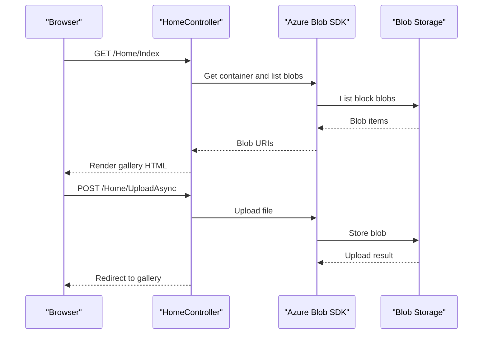

# API & Service Communication Contracts

The application exposes four conventional MVC actions for viewing and maintaining a photo gallery. Browser requests are synchronous at the HTTP boundary; storage operations use the Azure Blob SDK's asynchronous methods.

## Service Catalog

| Service | Port | Category | Purpose |
|---|---|---|---|
| WebApp-Storage-DotNet | 20050 (IIS Express development setting) | API Layer / Web UI | Renders a photo gallery and manages Azure Blob Storage content |

## API Endpoints Inventory

| Service | Method | Path | Request Type | Response Type |
|---|---|---|---|---|
| WebApp-Storage-DotNet | GET | `/` or `/Home/Index` | No body | HTML view populated with blob URIs |
| WebApp-Storage-DotNet | POST | `/Home/UploadAsync` | Multipart form files | Redirect to gallery; error view on failure |
| WebApp-Storage-DotNet | POST | `/Home/DeleteImage` | `name` form value | Redirect to gallery; error view on failure |
| WebApp-Storage-DotNet | POST | `/Home/DeleteAll` | No body | Redirect to gallery; error view on failure |

## Management & Observability Endpoints

| Service | Endpoint | Custom Metrics |
|---|---|---|
| WebApp-Storage-DotNet | None identified | None identified |

## DTOs & Contracts

No dedicated request or response DTO classes are defined. `UploadAsync` consumes `Request.Files`, `DeleteImage` accepts a string form value, and `Index` passes a `List<Uri>` to its Razor view. MVC conventions serialize neither custom JSON nor API version metadata.

## Communication Patterns

The controller calls Azure Blob Storage directly through the Azure SDK; no internal service-to-service calls, gateway, message broker, service discovery, retry policy, or circuit breaker is configured. Storage operations are awaited where asynchronous SDK calls are used. The application configuration provides a development storage emulator connection string. No application-level authentication, authorization, or TLS configuration was identified.

## Service Technology Matrix

| Service | Web | Data Access | Discovery | Gateway | Actuator | Cache | Metrics |
|---|---|---|---|---|---|---|---|
| WebApp-Storage-DotNet | ASP.NET MVC 5 | Azure Blob SDK | None | None | None | None | None |

## Service Communication Sequence

