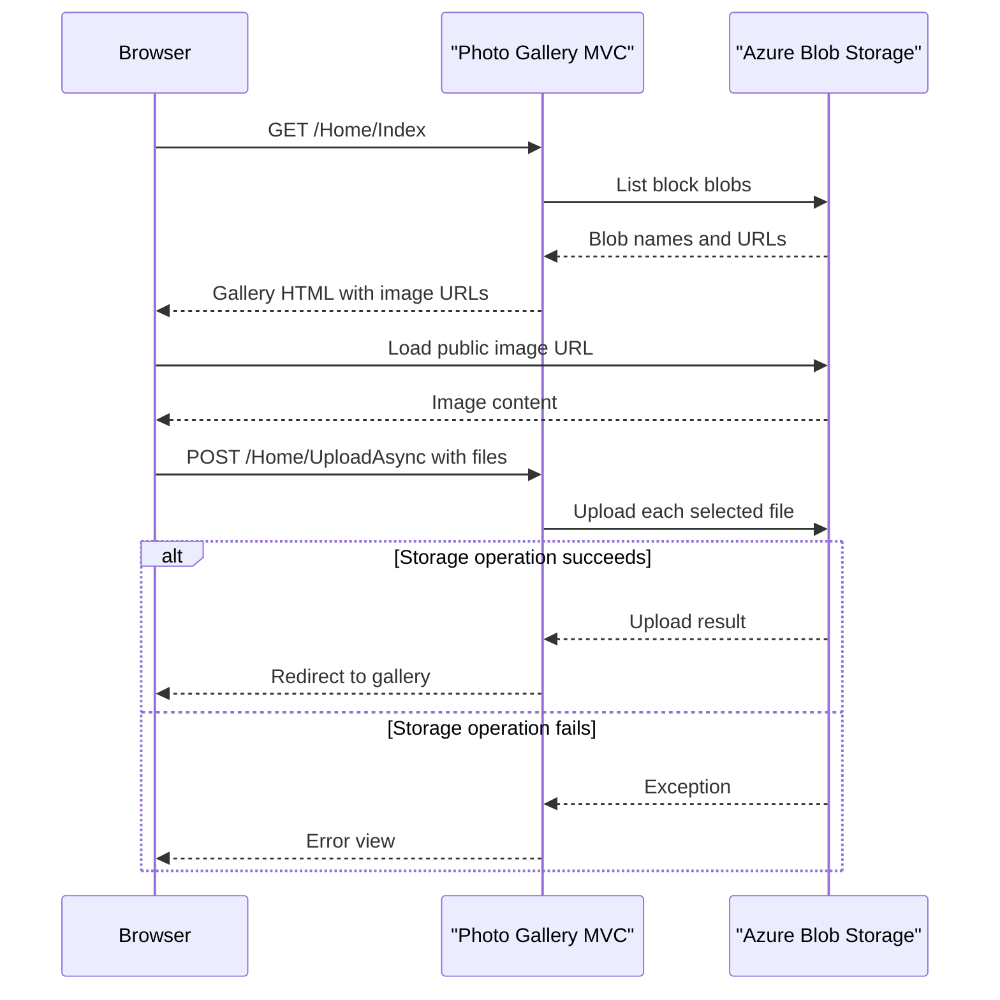

# API & Service Communication Contracts

The application exposes four MVC actions through conventional routes and uses synchronous browser-to-server HTTP requests with asynchronous Blob Storage SDK calls. No separately deployed application services or API specification are present.

## Service Catalog

| Service | Port | Category | Purpose |
|---|---|---|---|
| WebApp-Storage-DotNet | 20050 for configured IIS Express development; production port not specified | API Layer | Serves the gallery interface and manages images in Blob Storage |
| Azure Blob Storage | Not specified | Infrastructure | Persists image objects and serves public blob URLs |

## API Endpoints Inventory

| Service | Method | Path | Request Type | Response Type |
|---|---|---|---|---|
| WebApp-Storage-DotNet | GET | `/Home/Index` (default `/`) | None | HTML gallery view with `List<Uri>` model |
| WebApp-Storage-DotNet | POST | `/Home/UploadAsync` | Multipart form files | Redirect to `Home/Index`, or error view |
| WebApp-Storage-DotNet | POST | `/Home/DeleteImage` | Form parameter `name` containing a blob URI | Redirect to `Home/Index`, or error view |
| WebApp-Storage-DotNet | POST | `/Home/DeleteAll` | None | Redirect to `Home/Index`, or error view |

## Management & Observability Endpoints

No health-check, metrics, management, or API documentation endpoints were found. No custom metrics are registered.

## DTOs & Contracts

No explicit request/response DTO classes, OpenAPI specification, protobuf schema, or GraphQL schema were found. The gallery action passes a `List<Uri>` to its Razor view; uploads use the MVC `Request.Files` collection, and image deletion binds the `name` action parameter. The application has no custom JSON serialization configuration.

## Communication Patterns

The browser communicates with MVC using HTTP requests and multipart form submissions. Controller actions call the Azure Blob Storage SDK directly; the SDK operations use the configured storage endpoint, with `UseDevelopmentStorage=true` as the checked-in default. The controller uses asynchronous SDK calls for container creation, upload, and deletion, while blob enumeration is synchronous.

No application-level retries, circuit breakers, bulkheads, service discovery, API gateway, or inter-service messaging are configured. The only route composition is conventional MVC routing. No authentication, authorization, or HTTPS-enforcement configuration was found; blob reads are explicitly public, and app-level actions do not check user identity or roles.

## Service Technology Matrix

| Service | Web | Data Access | Discovery | Gateway | Actuator | Cache | Metrics |
|---|---|---|---|---|---|---|---|
| WebApp-Storage-DotNet | ASP.NET MVC 5 | Azure Storage Blobs SDK | None | None | None | None | None |
| Azure Blob Storage | Azure Storage endpoint | Blob API | Not applicable | None | Not applicable | Not identified | Not identified |

## Service Communication Sequence

