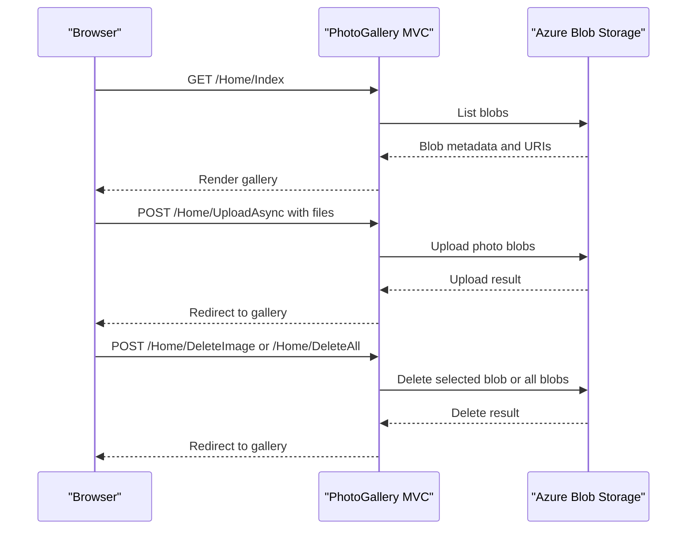

# API & Service Communication Contracts

The application exposes four MVC actions through browser-oriented HTTP requests and has no separate service-to-service API. Requests are synchronous at the application boundary, with asynchronous blob upload and deletion calls to Azure Storage.

## Service Catalog

| Service | Port | Category | Purpose |
|---|---|---|---|
| WebApp-Storage-DotNet | Not specified | API Layer | Serves the gallery UI and handles photo operations |
| Azure Blob Storage | External HTTPS endpoint | Infrastructure | Stores and serves photo blobs |

## API Endpoints Inventory

| Service | Method | Path | Request Type | Response Type |
|---|---|---|---|---|
| HomeController | GET | `/Home/Index` | None | Razor gallery view or error view |
| HomeController | POST | `/Home/UploadAsync` | Multipart form file collection | Redirect to gallery or error view |
| HomeController | POST | `/Home/DeleteImage` | Form field `Name` containing blob URI | Redirect to gallery or error view |
| HomeController | POST | `/Home/DeleteAll` | None | Redirect to gallery or error view |

No explicit API versioning scheme, REST DTOs, or separate API controller is present.

## Management & Observability Endpoints

| Service | Endpoint | Custom Metrics |
|---|---|---|
| WebApp-Storage-DotNet | None identified | None identified |

## DTOs & Contracts

The application does not define request or response DTO classes. MVC binds uploaded content through `Request.Files`; gallery view data is a list of blob URIs. The Azure SDK supplies blob metadata types. No OpenAPI, protobuf, or GraphQL contracts were found.

## Communication Patterns

The browser communicates with the MVC application over HTTP. The controller directly calls Azure Blob Storage using the Azure SDK for listing, uploading, and deleting. No message broker, service discovery, API gateway, retry policy, circuit breaker, or explicit timeout policy was identified. The application code does not configure API authentication or authorization, and it enables public blob reads when creating the container. TLS for storage is provided by the external Azure endpoint; no application-level HTTPS enforcement was identified.

## Service Technology Matrix

| Service | Web | Data Access | Discovery | Gateway | Actuator | Cache | Metrics |
|---|---|---|---|---|---|---|---|
| WebApp-Storage-DotNet | ASP.NET MVC 5 | Azure Blob SDK | None | None | None | None | None |
| Azure Blob Storage | Managed service | Blob API | N/A | N/A | Managed | N/A | Managed |

## Service Communication Sequence

