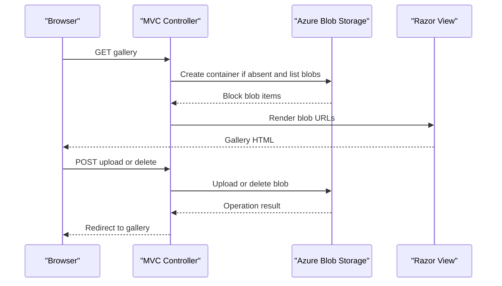

# API & Service Communication Contracts

The application exposes four MVC actions through the default route and communicates synchronously with Azure Blob Storage. No separate deployable service or API gateway was identified.

## Service Catalog

| Service | Port | Category | Purpose |
|---|---|---|---|
| WebApp-Storage-DotNet | Configured by the IIS/IIS Express host; local project setting is port 20050 | API Layer | Serves the gallery UI and performs blob operations |
| Azure Blob Storage | External service endpoint | Infrastructure | Stores image blobs and returns their public URLs |

## API Endpoints Inventory

| Service | Method | Path | Request Type | Response Type |
|---|---|---|---|---|
| WebApp-Storage-DotNet | GET | `/` or `/Home/Index` | None | Gallery view with blob URLs |
| WebApp-Storage-DotNet | POST | `/Home/UploadAsync` | Multipart form files | Redirect to `Home/Index` |
| WebApp-Storage-DotNet | POST | `/Home/DeleteImage` | Form value `Name` containing a blob URI | Redirect to `Home/Index` |
| WebApp-Storage-DotNet | POST | `/Home/DeleteAll` | None | Redirect to `Home/Index` |

The routes use the default `{controller}/{action}/{id}` MVC route. No API versioning scheme or dedicated request/response DTOs were found.

## Management & Observability Endpoints

| Service | Endpoint | Custom Metrics |
|---|---|---|
| WebApp-Storage-DotNet | None found | None found |

## DTOs & Contracts

No application-defined DTOs, API contract classes, OpenAPI documents, protobuf schemas, or GraphQL schemas were found. MVC actions bind uploaded files through `Request.Files` and bind the delete name as a string. The index action returns a list of blob `Uri` values to a Razor view. The Azure SDK supplies blob item and URI types; application code does not configure custom serialization.

## Communication Patterns

MVC actions make synchronous Azure Blob Storage SDK calls, with asynchronous upload and delete operations awaited by the controller. There are no message brokers, service discovery, gateway aggregation, retries, circuit breakers, explicit timeout policies, or multi-service startup dependencies. The storage endpoint is selected from the configured connection string. No application authentication, authorization checks, or TLS policy is configured in application code; transport security depends on deployment configuration.

## Service Technology Matrix

| Service | Web | Data Access | Discovery | Gateway | Actuator | Cache | Metrics |
|---|---|---|---|---|---|---|---|
| WebApp-Storage-DotNet | ASP.NET MVC 5 | Azure Storage SDK | None | None | None | None | None |
| Azure Blob Storage | Azure Storage REST service | Blob API | Fixed connection string | None | Provider-managed | Provider-managed | Provider-managed |

## Service Communication Sequence

