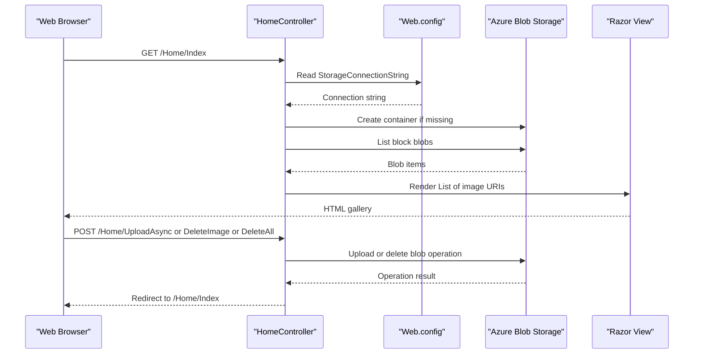

# API & Service Communication Contracts

PhotoGallery exposes four MVC routes for displaying, uploading, and deleting gallery images. Requests are handled synchronously by the web application, which calls Azure Blob Storage through its client SDK; no asynchronous message communication is configured.

## Service Catalog

| Service | Port | Category | Purpose |
|---|---|---|---|
| WebApp-Storage-DotNet | 20050 (configured for local IIS development) | API Layer | Serves the photo gallery and manages image blobs |
| Azure Blob Storage | External service; not configured here | Infrastructure | Stores gallery images |

## API Endpoints Inventory

The default MVC route is `/{controller}/{action}/{id}` with `Home/Index` as its default. No API versioning scheme is configured.

| Service | Method | Path | Request Type | Response Type |
|---|---|---|---|---|
| WebApp-Storage-DotNet | GET | `/Home/Index` | No body | Razor view with a list of blob URIs; errors return the Error view |
| WebApp-Storage-DotNet | POST | `/Home/UploadAsync` | Multipart form files (`Request.Files`) | Redirect to `/Home/Index`; errors return the Error view |
| WebApp-Storage-DotNet | POST | `/Home/DeleteImage` | Form parameter `Name` containing an image URI | Redirect to `/Home/Index`; errors return the Error view |
| WebApp-Storage-DotNet | POST | `/Home/DeleteAll` | No body | Redirect to `/Home/Index`; errors return the Error view |

## Management & Observability Endpoints

| Service | Endpoint | Custom Metrics (if any) |
|---|---|---|
| WebApp-Storage-DotNet | None detected | None detected |

## DTOs & Contracts

No dedicated request or response DTO classes are defined. The Index action passes a `List<Uri>` to its Razor view; upload and deletion requests use MVC form/file-binding inputs. No gateway-level aggregation models, OpenAPI/Swagger specifications, protobuf schemas, or GraphQL schemas were found. JSON serialization settings are not configured for these routes.

## Communication Patterns

The browser communicates with MVC actions over HTTP. The controller uses the Azure Storage Blobs SDK to synchronously list blobs and asynchronously upload or delete them; no queue, event bus, service discovery, API gateway, retries, circuit breaker, timeout policy, or client-side load balancing is configured. Storage settings are read from application configuration. The inspected project configuration contains no authentication, authorization, or TLS configuration; the configured local IIS development URL uses HTTP.

## Service Technology Matrix

| Service | Web | Data Access | Discovery | Gateway | Actuator | Cache | Metrics |
|---|---|---|---|---|---|---|---|
| WebApp-Storage-DotNet | ASP.NET MVC 5 | Azure Blob SDK | None | None | None | None | None |
| Azure Blob Storage | External storage API | Blob storage | N/A | N/A | N/A | N/A | Not configured here |

## Service Communication Sequence

