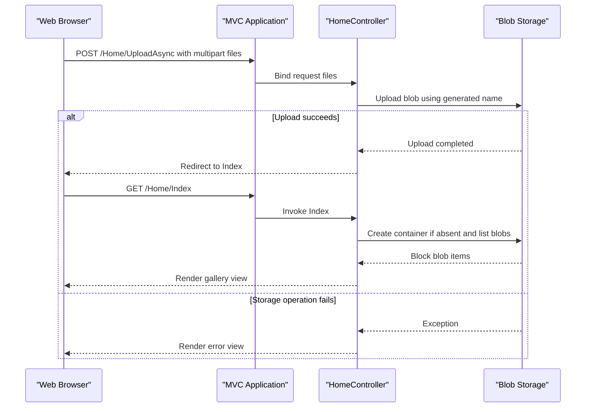

# API & Service Communication Contracts

The application exposes four MVC actions for gallery viewing and image management. Requests and responses are synchronous HTTP interactions, with Blob Storage SDK calls made from the controller.

## Service Catalog

| Service | Port | Category | Purpose |
|---|---|---|---|
| WebApp-Storage-DotNet | Configured by hosting/IIS | API and presentation | Serves the gallery and coordinates image operations |
| Azure Blob Storage | Configured by connection string | Infrastructure | Stores and serves image blobs |

## API Endpoints Inventory

| Service | Method | Path | Request Type | Response Type |
|---|---|---|---|---|
| WebApp-Storage-DotNet | GET | `/Home/Index` (also default route `/`) | None | Gallery Razor view containing blob URIs |
| WebApp-Storage-DotNet | POST | `/Home/UploadAsync` | Multipart form files | Redirect to `Index`; error view on exception |
| WebApp-Storage-DotNet | POST | `/Home/DeleteImage` | Form value `name` | Redirect to `Index`; error view on exception |
| WebApp-Storage-DotNet | POST | `/Home/DeleteAll` | No required body | Redirect to `Index`; error view on exception |

Routes use the conventional `/{controller}/{action}/{id?}` MVC route. No API versioning scheme is configured.

## Management & Observability Endpoints

| Service | Endpoint | Custom Metrics |
|---|---|---|
| WebApp-Storage-DotNet | None identified | None identified |

## DTOs & Contracts

No dedicated request or response DTO classes are defined. The gallery action passes a list of `Uri` values to the Razor view. Upload requests use ASP.NET's `Request.Files` collection, while delete requests bind the `name` form value to a string parameter. No OpenAPI/Swagger, protobuf, or GraphQL contract was found.

## Communication Patterns

Browser-to-application communication is synchronous HTTP using MVC actions. The application communicates with Blob Storage through the Azure Storage SDK, which issues storage service requests; the connection string is read from application settings. There is no message broker, service discovery, API gateway, client-side load balancer, custom retry policy, timeout policy, or circuit breaker configured in the application.

No authentication or authorization filter is registered, and the routes do not enforce TLS. The storage container is created with public blob-read access. Startup does not check storage readiness until the gallery action creates or opens the container.

## Service Technology Matrix

| Service | Web | Data Access | Discovery | Gateway | Health | Cache | Metrics |
|---|---|---|---|---|---|---|---|
| WebApp-Storage-DotNet | ASP.NET MVC 5 | Azure Storage Blobs SDK | None | None | None | None | None |
| Azure Blob Storage | Blob REST service | Object storage | Not applicable | Not applicable | Provider-managed | Not identified | Not identified |

## Service Communication Sequence

