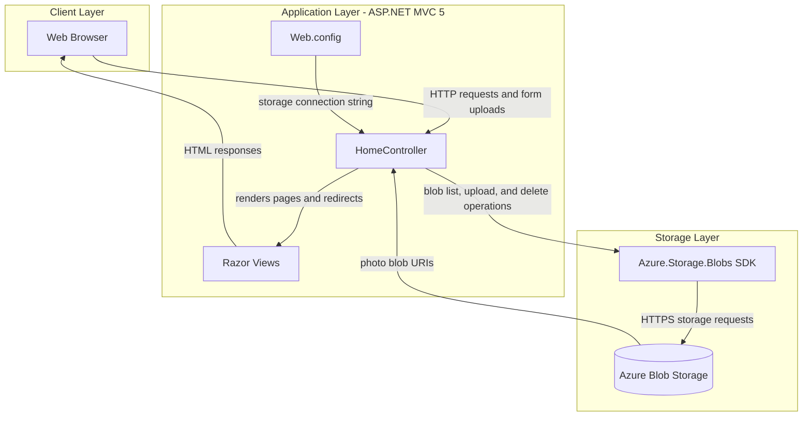
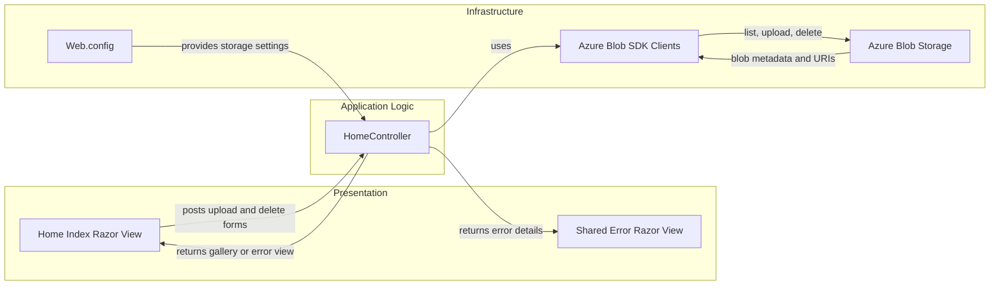

# Architecture Diagram

PhotoGallery is a single ASP.NET MVC web application that serves a Razor UI and uses Azure Blob Storage for photo persistence. No database or independently deployable backend service was identified.

## Application Architecture

### Technology Stack Summary

| Layer | Technology | Version | Purpose |
|---|---|---|---|
| Presentation | ASP.NET MVC | 5.2.3 | Routes browser requests and renders views |
| View | Razor | 3.2.3 | Server-rendered HTML |
| Runtime | .NET Framework | 4.8 | Application runtime |
| Storage integration | Azure.Storage.Blobs | 12.9.1 | Blob listing, upload, and deletion |
| Persistence | Azure Blob Storage | External service | Stores photo content |

### Data Storage & External Services

Photo files are stored in an Azure Blob Storage container. The application does not define a relational database, cache, message broker, or other external API. The configured local default is the development storage emulator.

### Key Architectural Decisions

- The MVC controller combines request handling with Azure storage operations; no separate service or repository layer is present.
- Photo metadata is obtained from the blob listing rather than a separate application database.
- The container is created with public blob read access.

## Component Relationships

### Component Inventory

| Component | Layer | Type | Responsibility |
|---|---|---|---|
| Home/Index | Presentation | Razor view | Displays photos and upload/delete controls |
| Shared/Error | Presentation | Razor view | Displays request errors |
| HomeController | Application Logic | MVC controller | Lists, uploads, and deletes blobs |
| Web.config | Infrastructure | Configuration | Supplies storage and ASP.NET settings |
| Azure Blob Storage | Infrastructure | External object store | Persists photo blobs |
