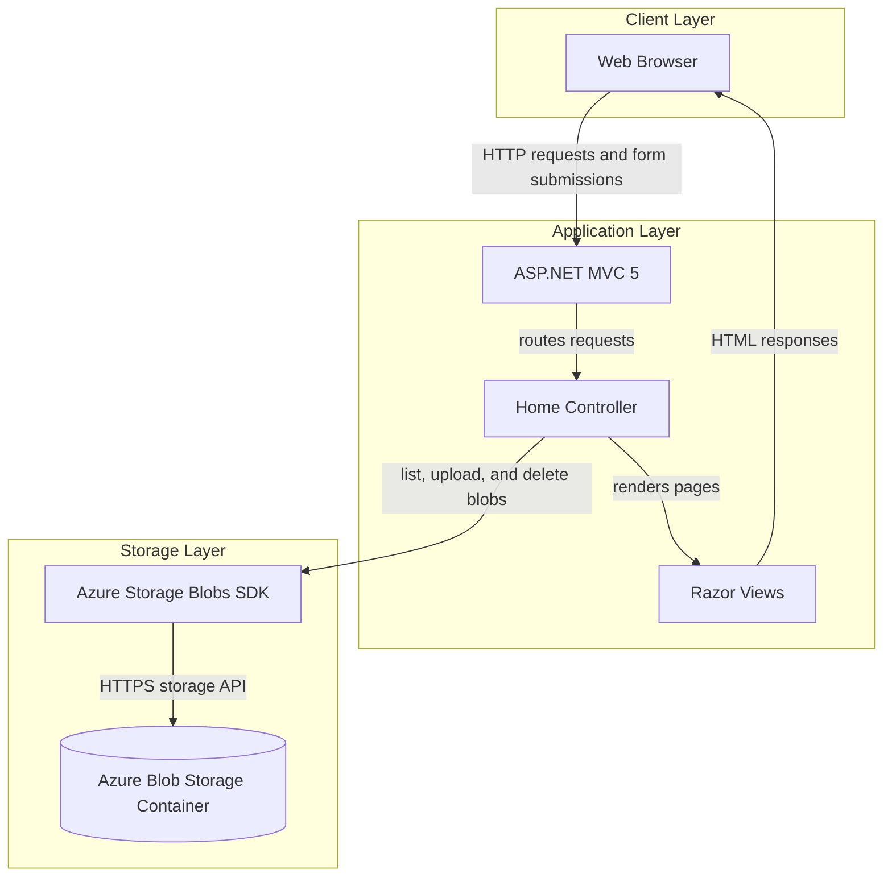
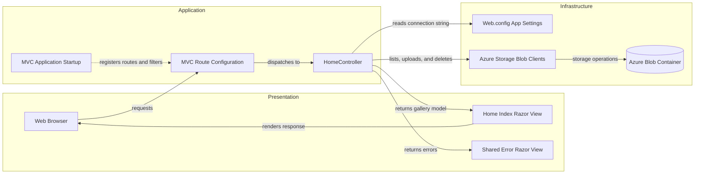

# Architecture Diagram

PhotoGallery is a server-rendered ASP.NET MVC application that provides a browser interface for managing images in Azure Blob Storage. The MVC controller communicates directly with the storage service using the Azure Storage Blobs client library.

## Application Architecture

### Technology Stack Summary

| Layer | Technology | Version | Purpose |
|---|---|---|---|
| Presentation | ASP.NET MVC | 5.2.3 | Handles web requests and renders server-side views |
| Presentation | Razor | 3.2.3 | Produces HTML views |
| Application | .NET Framework | 4.8 | Application runtime and framework |
| Storage integration | Azure.Storage.Blobs | 12.9.1 | Lists, uploads, and deletes gallery images |
| Storage | Azure Blob Storage | Configured externally | Persists image blobs in a named container |

### Data Storage & External Services

The application has no relational database or cache. Images are stored as block blobs in the `webappstoragedotnet-imagecontainer` container. The storage connection string is read from the `StorageConnectionString` application setting; the checked-in configuration defaults to the local development storage emulator.

### Key Architectural Decisions

- Uses server-rendered ASP.NET MVC and Razor for the browser interface.
- The `HomeController` directly invokes the Azure Blob Storage SDK; no separate service or repository layer is present.
- Stores gallery images as blobs rather than in a database.

## Component Relationships

### Component Inventory

| Component | Layer | Type | Responsibility |
|---|---|---|---|
| MVC Application Startup | Application | ASP.NET application startup | Registers routes, filters, and bundles |
| MVC Route Configuration | Application | MVC configuration | Maps requests to the default Home/Index action |
| HomeController | Application | MVC controller | Lists, uploads, and deletes gallery blobs |
| Home Index Razor View | Presentation | Razor view | Displays image thumbnails and upload/delete controls |
| Shared Error Razor View | Presentation | Razor view | Displays controller error details |
| Web.config App Settings | Infrastructure | Configuration | Provides the storage connection string |
| Azure Storage Blob Clients | Infrastructure | SDK clients | Communicates with Azure Blob Storage |
| Azure Blob Container | Infrastructure | Object storage | Persists image files |
