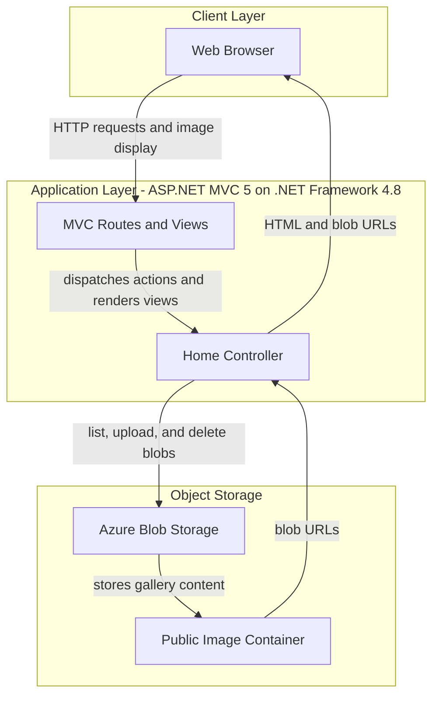
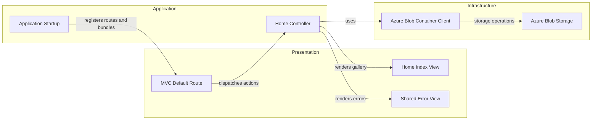

# Architecture Diagram

PhotoGallery is a single ASP.NET MVC web application that serves a browser-based gallery and accesses Azure Blob Storage directly. The application has no separate service tier or relational database.

## Application Architecture

### Technology Stack Summary

| Layer | Technology | Version | Purpose |
|---|---|---|---|
| Presentation | ASP.NET MVC | 5.2.3 | Routes requests and renders Razor views |
| Runtime | .NET Framework | 4.8 | Hosts the web application |
| Storage integration | Azure.Storage.Blobs | 12.9.1 | Lists, uploads, and deletes image blobs |
| Browser UI | Razor, Bootstrap, jQuery | Razor 3.2.3; Bootstrap 3.0.0; jQuery 1.10.2 | Gallery and upload interface |

### Data Storage & External Services

Azure Blob Storage is the application's only persistent data store. `HomeController` uses a configured storage connection string to access a fixed container; the container is created with public blob-read access. No database, cache, message broker, or other external API integration was identified.

### Key Architectural Decisions

- The MVC controller communicates directly with Azure Blob Storage; no service or repository layer is present.
- Image records are represented as blob objects, and the browser receives direct blob URLs.
- The blob container client is held in a static field and initialized during the gallery index action.

## Component Relationships

### Component Inventory

| Component | Layer | Type | Responsibility |
|---|---|---|---|
| MVC Default Route | Presentation | MVC route | Maps controller/action URLs and defaults to `Home/Index` |
| Home Index View | Presentation | Razor view | Displays blob URLs and provides upload and delete forms |
| Shared Error View | Presentation | Razor view | Displays exception details supplied by the controller |
| Application Startup | Application | `HttpApplication` | Registers areas, filters, routes, and bundles |
| Home Controller | Application | MVC controller | Lists, uploads, and deletes blobs |
| Azure Blob Container Client | Infrastructure | Azure SDK client | Performs blob operations against the configured container |
| Azure Blob Storage | Infrastructure | External storage service | Persists gallery image objects |
