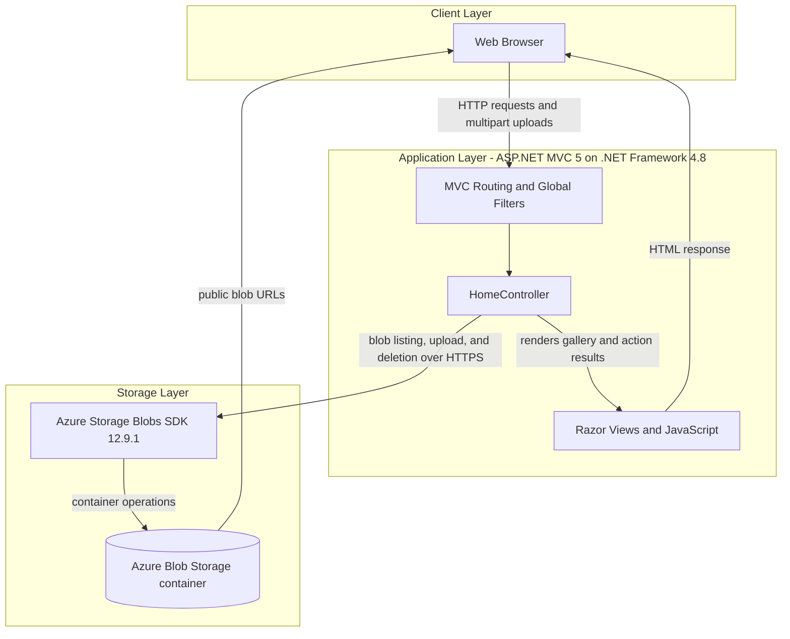
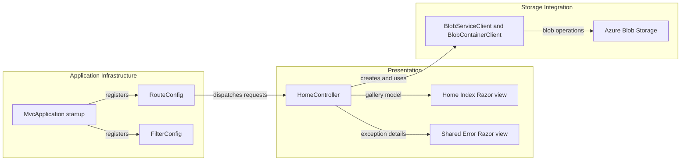

# Architecture Diagram

This single-project photo gallery serves a server-rendered web interface and uses Azure Blob Storage for image persistence. There is no relational database or separately deployed application service.

## Application Architecture

### Technology Stack Summary

| Layer | Technology | Version | Purpose |
|---|---|---:|---|
| Presentation | ASP.NET MVC | 5.2.3 | Routes browser requests to controller actions and renders Razor views |
| Runtime | .NET Framework | 4.8 | Hosts the web application |
| Storage integration | Azure.Storage.Blobs | 12.9.1 | Lists, uploads, and deletes blob objects |
| Web UI | Razor, jQuery, Bootstrap | 3.2.3, 1.10.2, 3.0.0 | Server-rendered gallery and browser interactions |
| Hosting | IIS Express / Azure Web Apps | Not pinned | Local and documented cloud hosting |

### Data Storage & External Services

Azure Blob Storage is the only application persistence service. The application lists block blobs, uploads objects, and deletes them; there is no database, cache, or message broker. The container is created with public blob-read access, so browsers can load the resulting blob URLs directly.

### Key Architectural Decisions

- A single MVC controller combines request handling and direct Blob Storage operations; no separate service or repository layer is defined.
- Blob objects, rather than relational records, are the gallery's persistence model.
- The container is accessed through a mutable static `BlobContainerClient` shared by controller requests.

## Component Relationships

### Component Inventory

| Component | Layer | Type | Responsibility |
|---|---|---|---|
| HomeController | Presentation | MVC Controller | Lists blobs and handles upload and deletion requests |
| Home Index view | Presentation | Razor View | Displays gallery images and submits browser actions |
| Shared Error view | Presentation | Razor View | Displays controller exception details |
| MvcApplication | Application Infrastructure | ASP.NET application startup | Registers routes, global filters, and bundles |
| RouteConfig | Application Infrastructure | MVC routing configuration | Maps the default route to `Home/Index` |
| FilterConfig | Application Infrastructure | MVC filter configuration | Registers the global error handler |
| BlobServiceClient / BlobContainerClient | Storage Integration | Azure SDK clients | Communicate with the configured Blob Storage service |
