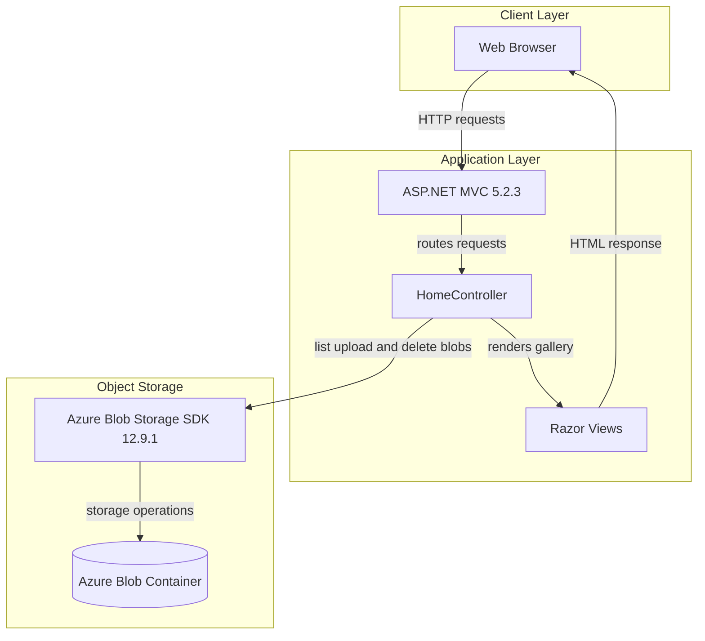
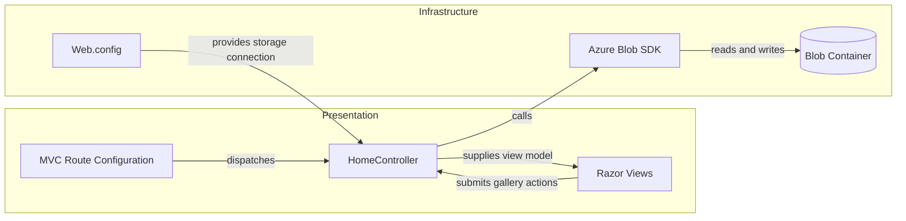

# Architecture Diagram

PhotoGallery is a single ASP.NET MVC web application that renders gallery pages and stores photo blobs in Azure Blob Storage. No separate service tier or relational database is configured.

## Application Architecture

### Technology Stack Summary

| Layer | Technology | Version | Purpose |
|---|---|---|---|
| Presentation | ASP.NET MVC | 5.2.3 | Routes browser requests and renders server-side views |
| Runtime | .NET Framework | 4.8 | Hosts the web application |
| View | Razor | 3.2.3 | Renders HTML pages |
| Object storage | Azure.Storage.Blobs | 12.9.1 | Stores and retrieves photo blobs |
| Static assets | Bootstrap, jQuery | 3.0.0, 1.10.2 | Browser styling and client-side behavior |

### Data Storage & External Services

The application uses Azure Blob Storage as its only persistent store; it does not configure a database, cache, or message broker. The container is created with blob-level public read access, and the application lists, uploads, and deletes block blobs through the Azure SDK.

### Key Architectural Decisions

- A single MVC application handles presentation, request orchestration, and storage calls.
- Photo content is stored as unstructured blobs rather than in a relational data store.
- The shared blob container client is held in a static controller field.

## Component Relationships

### Component Inventory

| Component | Layer | Type | Responsibility |
|---|---|---|---|
| RouteConfig | Presentation | MVC routing | Maps conventional controller/action routes |
| HomeController | Presentation | MVC controller | Lists photos and handles upload and delete actions |
| Razor views | Presentation | Server-rendered views | Displays the gallery and submits user actions |
| Web.config | Infrastructure | Application configuration | Supplies storage connection and ASP.NET runtime settings |
| Azure Blob SDK | Infrastructure | Storage client library | Performs blob container operations |
| Blob container | Data storage | Object store | Holds uploaded photo blobs |
