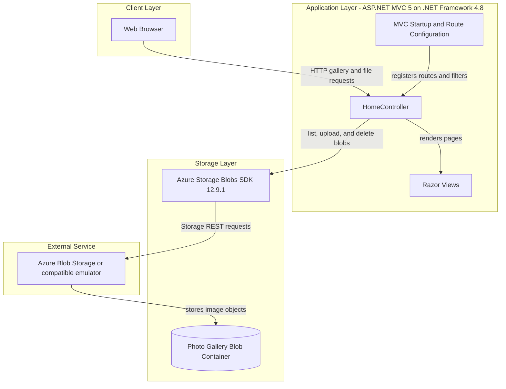
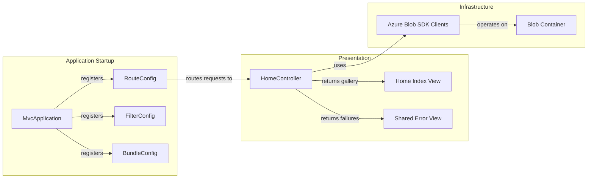

# Architecture Diagram

The application presents a browser-based photo gallery and delegates image storage to a Blob Storage service. It is a single ASP.NET MVC application with no separate business-service or database tier.

## Application Architecture

### Technology Stack Summary

| Layer | Technology | Version | Purpose |
|---|---|---:|---|
| Presentation | ASP.NET MVC | 5.2.3 | Routes browser requests and renders views |
| View | Razor / ASP.NET WebPages | 3.2.3 | Server-rendered gallery and error pages |
| Runtime | .NET Framework | 4.8 | Hosts the web application |
| Storage integration | Azure.Storage.Blobs | 12.9.1 | Lists, uploads, and deletes blob objects |
| Storage service | Azure Blob Storage-compatible endpoint | Configured externally | Persists gallery images |

### Data Storage & External Services

Images are stored as block blobs in `webappstoragedotnet-imagecontainer`. The checked-in configuration selects development storage with `UseDevelopmentStorage=true`; a deployed environment must supply a storage connection string. There is no relational database, cache, message broker, or other external API.

### Key Architectural Decisions

- The MVC controller directly coordinates page requests and Blob Storage operations; no separate service or repository layer is present.
- Gallery images are exposed with blob-level public read access when the container is created.
- The application uses asynchronous upload and delete SDK operations, while listing blobs is performed synchronously.

## Component Relationships

### Component Inventory

| Component | Layer | Type | Responsibility |
|---|---|---|---|
| HomeController | Presentation/application | MVC Controller | Lists, uploads, and deletes gallery blobs |
| Home Index View | Presentation | Razor View | Displays image links and upload/delete controls |
| Shared Error View | Presentation | Razor View | Displays error text and stack trace |
| MvcApplication | Startup | ASP.NET application class | Registers routes, global filters, and bundles |
| RouteConfig | Startup | MVC configuration | Maps controller/action routes |
| FilterConfig | Startup | MVC configuration | Registers the standard error filter |
| BundleConfig | Startup | Asset configuration | Registers JavaScript and CSS bundles |
| Azure Blob SDK Clients | Infrastructure | Storage client | Communicates with the configured Blob Storage endpoint |
