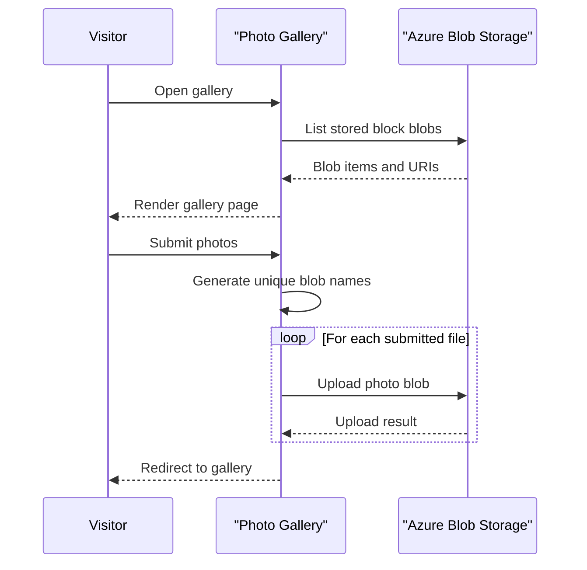

# Core Business Workflows

PhotoGallery lets a visitor browse, upload, and delete photo blobs in a gallery. The application has one photo-gallery domain and delegates persistence to a single Azure Blob Storage container.

## Domain Entities

| Entity | Service / Bounded Context | Description | Key Relationships |
|---|---|---|---|
| Photo blob | WebApp-Storage-DotNet / Photo Gallery | An image or other uploaded object displayed as a gallery item | Belongs to the gallery container |
| Gallery container | WebApp-Storage-DotNet / Photo Gallery | Collection of stored photo blobs | Contains many photo blobs |

## Service-to-Domain Mapping

| Service | Domain Context | Owned Entities | External Dependencies |
|---|---|---|---|
| WebApp-Storage-DotNet | Photo Gallery | Gallery container and photo blobs | Azure Blob Storage |

The web application is the only service and is the source of truth for gallery operations. It communicates directly with Blob Storage; there is no cross-service data exchange or response aggregation.

## Primary Workflows

### Workflow 1: Browse the gallery

1. A visitor requests the default gallery page.
2. `HomeController.Index` resolves the configured container and lists its block blobs.
3. The controller supplies blob URIs to the view, which renders links and thumbnails.
4. If storage access fails, the application returns the error view.

### Workflow 2: Upload photos

1. A visitor submits one or more files using the multipart form.
2. `HomeController.UploadAsync` iterates over submitted files and generates a blob name from a timestamp, GUID, and filename extension.
3. Each blob is uploaded in sequence; on success the visitor is redirected to the gallery.
4. On failure the error view is shown. There is no transaction spanning multiple files, so earlier uploads may remain if a later upload fails.

### Workflow 3: Delete photos

The visitor can delete one image or all listed block blobs. The single-image action derives a blob name from the submitted URI; the delete-all action lists block blobs and deletes them in sequence. Successful actions redirect to the gallery.

## Cross-Service Data Flows

No cross-service flow or aggregation exists. The MVC application directly lists, uploads, and deletes data in its Azure Blob Storage container; no downstream service fallback is configured.

## Business Workflow Sequence

## Business Rules & Decision Logic

- The gallery displays and deletes only blobs whose type is `Block`.
- New names include a timestamp and GUID and retain the submitted filename extension.
- Upload and delete-all actions operate sequentially; no multi-item transaction or compensation is defined.
- Errors are returned through the error view; no audit trail for gallery changes is configured.
- The application does not define authentication or per-user ownership rules for gallery content.
