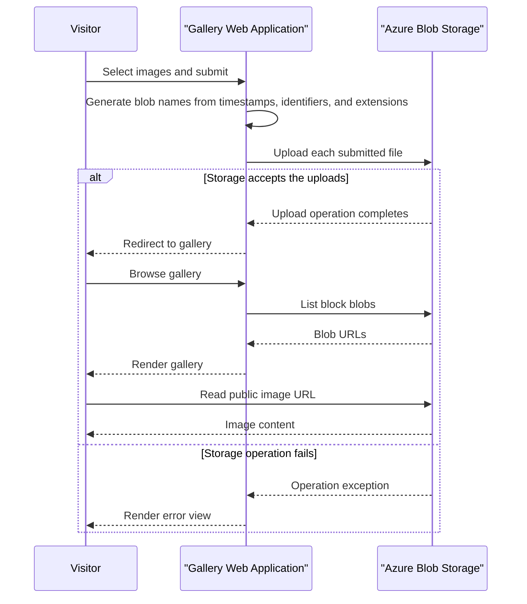

# Core Business Workflows

The application provides a simple image gallery: users can browse stored images, upload images, remove one image, or clear the gallery. Gallery items are represented by objects in a single storage container.

## Domain Entities

| Entity | Service / Bounded Context | Description | Key Relationships |
|---|---|---|---|
| Image blob | WebApp-Storage-DotNet / Gallery | User-provided image object displayed in the gallery | Stored in the gallery container; exposed to the browser through its blob URL |
| Blob container | Azure Blob Storage / Image persistence | Collection of gallery objects | Contains image blobs |

No application-level domain entity classes or aggregates were found.

## Service-to-Domain Mapping

| Service | Domain Context | Owned Entities | External Dependencies |
|---|---|---|---|
| WebApp-Storage-DotNet | Photo Gallery | Gallery operations and image references | Azure Blob Storage |
| Azure Blob Storage | Image persistence | Stored image blobs | None identified |

There are no additional services, bounded contexts, or cross-context data exchanges.

## Primary Workflows

### Workflow 1: Browse the Gallery

1. A visitor opens the default gallery page.
2. `HomeController.Index` creates the configured container if needed and lists block blobs.
3. The controller passes blob URIs to the gallery view.
4. The browser loads each image directly from its public blob URL.

The workflow has no application-level sign-in, authorization, or per-image access check.

### Workflow 2: Upload Images

1. A visitor selects one or more files and submits the multipart form.
2. `HomeController.UploadAsync` iterates over the submitted files and creates a generated blob name using the original extension.
3. The controller sends the posted filename string to the Blob Storage SDK as the upload source path, then redirects to the gallery after successful processing.
4. If a storage operation throws an exception, the controller returns the error view.

No business validation for file type, content, or file count is present.

### Workflow 3: Delete Images

The single-image action accepts a URI string, extracts its final path segment as the blob name, and deletes that object if present. The delete-all action enumerates the container and deletes each block blob. Both actions redirect to the gallery on success and display an error view on failure.

## Cross-Service Data Flows

The application communicates only with Azure Blob Storage. The controller lists blob names and URIs for display, performs uploads and deletions, and the browser reads image content from public blob URLs. No aggregation across application services or fallback data source is implemented; storage failures yield an error view.

## Business Workflow Sequence

## Business Rules & Decision Logic

- The gallery displays only block blobs returned from the configured container.
- Uploaded blob names are generated from the current timestamp, a GUID, and the original file extension.
- A single-image deletion derives the blob name from the supplied URI; delete-all targets block blobs in the container.
- No upload-type, content, or count validation is implemented.
- No transaction, application-level audit trail, or business authorization rule was identified.
- Controller exceptions are returned to the error view with message and stack trace values.
