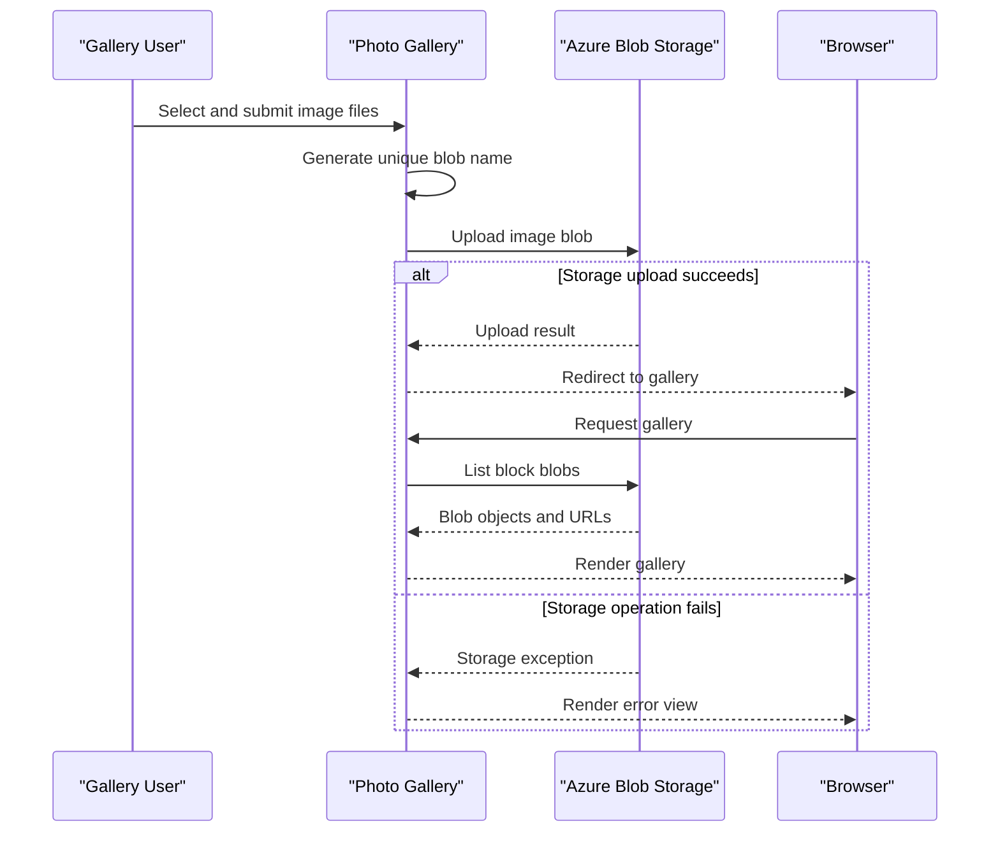

# Core Business Workflows

PhotoGallery lets a user browse image blobs in a gallery, upload image files, and delete one or all images. The application delegates persistence to a single Azure Blob Storage container.

## Domain Entities

| Entity | Service / Bounded Context | Description | Key Relationships |
|---|---|---|---|
| Image Blob | Photo Gallery | An image object persisted in the gallery container | Belongs to the gallery container |
| Gallery Container | Photo Gallery | Collection of image blobs shown by the application | Contains image blobs |

## Service-to-Domain Mapping

| Service | Domain Context | Owned Entities | External Dependencies |
|---|---|---|---|
| WebApp-Storage-DotNet | Photo Gallery | Gallery operations and blob naming | Azure Blob Storage |
| Azure Blob Storage | Object Persistence | Stored blob objects and container | None identified |

The application is the only web service. It communicates directly with storage; no shared database, message exchange, or cross-context aggregation is present.

## Primary Workflows

### Workflow 1: Browse Gallery

1. A browser requests the default `Home/Index` route.
2. The controller creates a blob service client from the configured connection string, selects the fixed gallery container, and creates it with public blob access if absent.
3. The controller lists blobs, selects block blobs, obtains their URIs, and supplies them to the gallery view.
4. The view renders image links and deletion controls.

### Workflow 2: Upload Images

1. A user selects one or more files in the gallery form and submits it to `Home/UploadAsync`.
2. The controller iterates over the submitted files, generates a random blob name using ticks, a GUID, and the original extension, then uploads each file through the Azure Blob SDK.
3. On success the browser is redirected to the gallery. Errors are shown on the shared error view.

### Workflow 3: Delete Images

The individual delete action accepts a submitted blob URI, derives its final path component, and deletes that blob if it exists. The delete-all action lists the container and deletes each block blob. Both actions redirect to the gallery when successful.

## Cross-Service Data Flows

The web application sends blob list, upload, and delete operations directly to Azure Blob Storage. Blob URLs returned by storage are used by the browser to display images. There is no service aggregation or fallback data source; a storage failure is returned as an error view.

## Business Workflow Sequence

## Business Rules & Decision Logic

- Only block blobs are displayed and removed by the gallery's list/delete-all flows.
- Upload names are generated from a time value, a GUID, and the submitted file extension.
- A single-image deletion derives the blob name from the supplied URI's local path.
- The container is configured to allow public blob reads.
- The application has no explicit authorization, ownership checks, transaction manager, audit trail, business validation, or compensating action. Errors are caught and surfaced through the shared error view.
