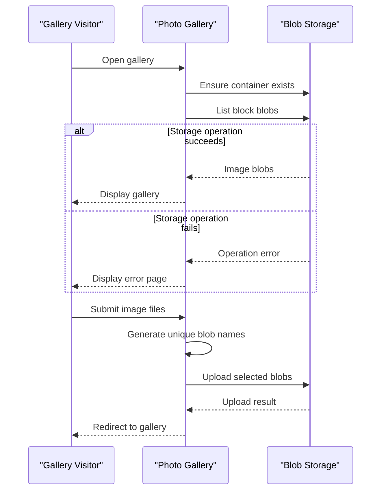

# Core Business Workflows

PhotoGallery lets users browse, add, and remove images in a shared gallery. Its business behavior is limited to basic image lifecycle operations; no broader domain processes or service orchestration were identified.

## Domain Entities

| Entity | Service / Bounded Context | Description | Key Relationships |
|---|---|---|---|
| Gallery image (blob) | WebApp-Storage-DotNet / Photo Gallery | An image stored as a blob and surfaced in the gallery | Belongs to the gallery's configured storage container |

## Service-to-Domain Mapping

| Service | Domain Context | Owned Entities | External Dependencies |
|---|---|---|---|
| WebApp-Storage-DotNet | Photo Gallery | Gallery images in its configured container | Azure Blob Storage |

## Primary Workflows

### Workflow 1: Browse the gallery

1. A visitor opens the gallery.
2. The application creates the image container if it does not exist.
3. The application lists blobs, selects block blobs, and provides their URIs to the gallery view.
4. If a storage operation fails, the application returns the Error view.

### Workflow 2: Add images

1. A visitor selects one or more files and submits the upload form.
2. The application generates a unique blob name using the current timestamp and a GUID while retaining the file extension.
3. Each selected file is uploaded to the configured container.
4. On success, the visitor is redirected to the gallery; on failure, the Error view is returned.

### Workflow 3: Remove images

1. A visitor chooses an image for deletion or submits the delete-all form.
2. For a single image, the application extracts the filename from the supplied URI and deletes that blob. For delete-all, it enumerates the container and deletes each block blob.
3. On success, the visitor is redirected to the gallery; on failure, the Error view is returned.

## Cross-Service Data Flows

There are no application-to-application service flows or data aggregation patterns. The web application reads and writes gallery images directly through Azure Blob Storage; a failed operation is surfaced using the Error view rather than a downstream fallback.

## Business Workflow Sequence

## Business Rules & Decision Logic

- Only block blobs are included when listing or deleting all gallery images.
- Uploaded blob names are made unique using a timestamp and GUID; the original file extension is retained.
- A single-image deletion derives the blob name from the supplied image URI.
- No application-level file validation, workflow state transitions, business authorization rules, or audit trail were identified.
- Blob operations are awaited, but no transaction or compensating workflow is configured. Exceptions are handled by returning the Error view.

