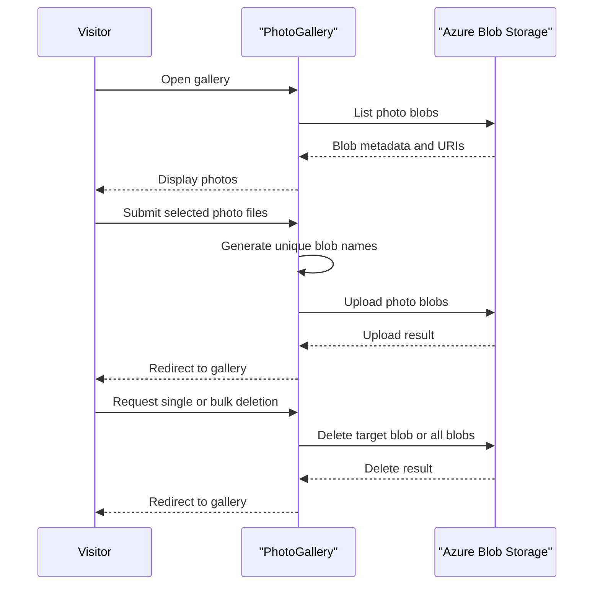

# Core Business Workflows

PhotoGallery lets users browse a gallery of photos stored as blobs, upload additional photos, and delete one or all stored photos. The primary business data is the photo content and its public blob URI.

## Domain Entities

| Entity | Service / Bounded Context | Description | Key Relationships |
|---|---|---|---|
| PhotoBlob | Photo Gallery | An uploaded image or other file stored in the blob container | Belongs to the gallery container |

## Service-to-Domain Mapping

| Service | Domain Context | Owned Entities | External Dependencies |
|---|---|---|---|
| WebApp-Storage-DotNet | Photo Gallery | Gallery operations and photo selection | Azure Blob Storage |
| Azure Blob Storage | Object Storage | Stored photo blobs | None identified |

## Primary Workflows

### Workflow 1: Browse the Photo Gallery

1. A visitor opens the gallery page.
2. The controller creates the storage client and ensures the gallery container exists.
3. The application lists block blobs, collects their URIs, and renders the gallery.
4. If storage access fails, an error view is returned.

### Workflow 2: Upload Photos

1. A visitor selects one or more files and submits the multipart form.
2. The controller creates a generated blob name using a timestamp, GUID, and uploaded file extension.
3. The content is uploaded to Azure Blob Storage and the visitor is redirected to the gallery.
4. No server-side file-type or business validation is identified.

### Workflow 3: Delete Photos

The visitor can submit a delete request for one displayed blob URI or request deletion of all block blobs. The controller resolves the blob name and calls the storage delete operation, then redirects to the gallery.

## Cross-Service Data Flows

The MVC application directly calls Azure Blob Storage. Blob names and URIs returned by storage are used to render the photo gallery. There are no additional services or response-composition flows. If storage is unavailable, the application displays an error rather than providing a cached or partial gallery.

## Business Workflow Sequence

## Business Rules & Decision Logic

- Only block blobs are displayed and selected for bulk deletion.
- A new blob name combines the current timestamp, a GUID, and the original file extension.
- Single-photo deletion extracts the final path component from the submitted URI before selecting the blob to delete.
- The application has no identified user authentication, ownership checks, or audit trail for uploads and deletions.
- No explicit transaction or compensating-action workflow is present; each blob operation is performed directly against storage.
