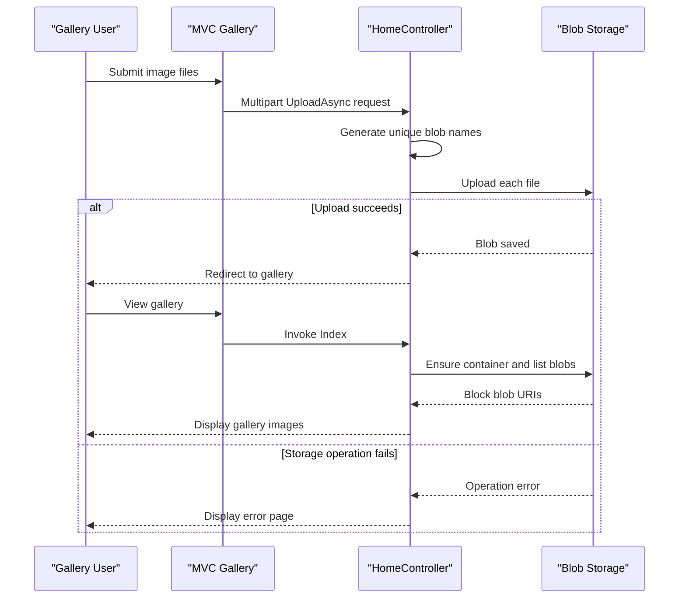

# Core Business Workflows

The application supports a simple photo-gallery experience: users view images stored in a shared gallery, upload new files, and remove individual images or all block blobs.

## Domain Entities

| Entity | Service / Bounded Context | Description | Key Relationships |
|---|---|---|---|
| Gallery | WebApp-Storage-DotNet / Gallery Management | The collection of images displayed to users | Contains stored image blobs |
| Image Blob | WebApp-Storage-DotNet / Gallery Management | A user-uploaded image object stored in the gallery container | Belongs to the gallery container |

## Service-to-Domain Mapping

| Service | Domain Context | Owned Entities | External Dependencies |
|---|---|---|---|
| WebApp-Storage-DotNet | Gallery Management | Gallery container and image blobs | Azure Blob Storage |
| Azure Blob Storage | Object storage | Blob content and metadata | None identified |

The web application is the only application service. It accesses the blob container directly; no cross-service domain exchange or aggregation is present.

## Primary Workflows

### Workflow 1: Browse the Gallery

1. The browser requests the home page.
2. `HomeController.Index` reads the storage connection string, obtains the gallery container, and creates it if it does not exist.
3. The controller lists blobs and includes block-blob URIs in the page model.
4. The Razor view displays the image thumbnails and links.

Only block blobs are included in the gallery. Blob access is configured as public read when the container is created.

### Workflow 2: Upload Images

1. The browser submits selected files as a multipart form request.
2. `HomeController.UploadAsync` iterates through the request's file collection.
3. A blob name is generated from the current tick count, a GUID, and the file extension.
4. The file is uploaded to the gallery container and the browser is redirected to the index page.

No file type or content validation is implemented. If there are no files, the action still redirects to the gallery.

### Workflow 3: Delete Images

The selected-image workflow parses the supplied URI, takes its final path segment as the blob name, and deletes that blob if present. The delete-all workflow enumerates the container and deletes each item whose type is block blob. Both actions redirect to the gallery after completion.

## Cross-Service Data Flows

There is no application-to-application data flow. The MVC application reads, writes, and deletes blobs directly through the Azure Storage SDK. The gallery page composes its view from the blob URIs returned by storage; when a storage operation fails, the application displays an error view instead of the gallery.

## Business Workflow Sequence

## Business Rules & Decision Logic

- The gallery lists only block blobs.
- Uploaded blob names use a generated timestamp/GUID prefix and retain the selected file's extension.
- The application does not impose file extension or content-type validation.
- Delete-one uses the final URI path segment as the blob name; delete-all removes all block blobs in the configured container.
- Storage operations are not wrapped in an application transaction, and no audit logging or user-level ownership checks are present.
