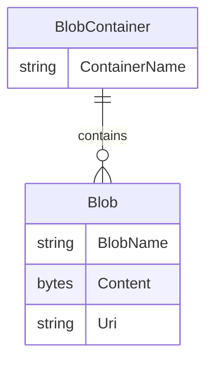

# Data Architecture & Persistence Layer

The application has no relational entities or ORM model; its gallery data consists of image blobs in one Azure Blob Storage container. Blob names and URLs are used by the controller and view as the application's only persisted references.

## Database Configuration

| Service/Module | DB Type | Profile | Driver | Connection | Migration Tool |
|---|---|---|---|---|---|
| WebApp-Storage-DotNet | Azure Blob Storage object store | Default local development setting points to storage emulator | Azure Storage Blobs SDK 12.9.1 | Configured in Web.config; no connection pool or migration tooling identified | None |

No SQL database, schema scripts, ORM, or migration framework was found.

## Data Ownership per Service

| Service | Tables Owned | ORM Framework | Caching | Notes |
|---|---|---|---|---|
| WebApp-Storage-DotNet | No tables; owns image objects in the gallery blob container | None | None | Direct Azure Storage SDK calls from `HomeController` |
| Azure Blob Storage | Blob objects | Not applicable | Not identified | The storage service is the persistence boundary |

## Entity Model

The source defines no application entity classes. The following diagram represents the external object-storage concepts only; container and blob are not relational entities or ORM models.

## Key Repository Methods

| Service | Repository | Notable Methods | Purpose |
|---|---|---|---|
| WebApp-Storage-DotNet | None | None | No repository interface or data-access abstraction is present; controller actions use `BlobContainerClient` and `BlobClient` directly. |

## Caching Strategy

No application cache, cache provider, cache-aside pattern, or query-result cache was identified. The mutable static container client is a shared SDK reference, not a data cache.

## Data Ownership Boundaries

There is one application and one external blob container, with no cross-service data access, shared relational database, or CQRS pattern. `HomeController` directly lists, uploads, and deletes blobs; the browser receives blob URLs and reads publicly accessible objects directly from storage. No separate source-of-truth boundary exists across application services.

### Data Classification & Sensitivity

| Entity | Sensitive Fields | Classification (PII/PHI/PCI/None) | Controls in Place |
|---|---|---|---|
| Uploaded image blob | Image content and associated metadata may contain identifiable information; exact content is user-supplied and not classified in code | Potential PII; no PHI or PCI model identified | No application-level masking or field-level access control found; container blobs are created with public read access. Encryption settings are not configured in the repository. |
