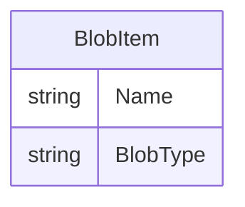

# Data Architecture & Persistence Layer

The application persists image files in a single Azure Blob Storage container. It defines no relational entities, ORM mappings, repository interfaces, or database migrations.

## Database Configuration

| Service/Module | DB Type | Profile | Driver | Connection | Migration Tool |
|---|---|---|---|---|---|
| WebApp-Storage-DotNet | Azure Blob Storage (object storage; not a database) | No profiles detected | Azure.Storage.Blobs SDK 12.9.1 | Connection string supplied through application settings; checked-in value targets local development storage | None |

## Data Ownership per Service

| Service | Tables Owned | ORM Framework | Caching | Notes |
|---|---|---|---|---|
| WebApp-Storage-DotNet | None; stores image blobs in its configured container | None | None detected | The controller directly uses the Azure Blob Storage SDK |

## Entity Model

There are no application-defined database entities or relational relationships. The diagram below represents the blob item returned by the Azure SDK, not a custom persisted entity.

No transaction management or ORM relationship mappings were found.

## Key Repository Methods

| Service | Repository | Notable Methods | Purpose |
|---|---|---|---|
| WebApp-Storage-DotNet | None | None | The controller calls Azure Blob SDK client methods directly; there are no repository interfaces or custom query methods. |

## Caching Strategy

No application cache, cache provider, or cache configuration was detected.

## Data Ownership Boundaries

The application is the only source service and stores images in a single configured Blob Storage container. It has no database-per-service or shared relational database topology, and it does not query data owned by another application service. There is no CQRS pattern or separate read/write store; the controller performs blob operations directly.

### Data Classification & Sensitivity

| Entity | Sensitive Fields | Classification (PII/PHI/PCI/None) | Controls in Place |
|---|---|---|---|
| Stored image blobs | Image content and blob names are not defined by the application and cannot be classified from source | Unknown; may contain user-provided personal or sensitive content | No application-level masking or field-level access controls identified; storage encryption and access controls depend on the configured storage account |
