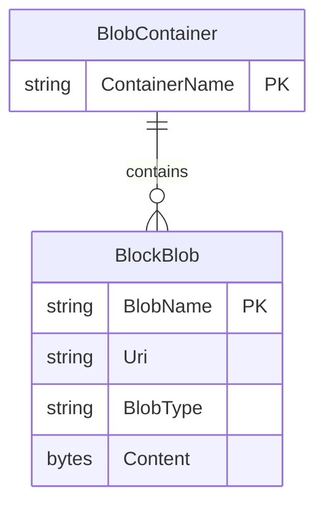

# Data Architecture & Persistence Layer

The application has no relational database, ORM, or application-defined entity model. Its data layer is Azure Blob Storage, used to persist and retrieve image objects in a single gallery container.

## Database Configuration

| Service/Module | DB Type | Profile | Driver | Connection | Migration Tool |
|---|---|---|---|---|---|
| WebApp-Storage-DotNet | Azure Blob object storage (not a database) | Default | Azure.Storage.Blobs 12.9.1 | `StorageConnectionString` uses `UseDevelopmentStorage=true` in Web.config | None |

No relational schema, database profile, seed data, or database migration tool was detected. The gallery container is created at runtime if absent.

## Data Ownership per Service

| Service | Tables Owned | ORM Framework | Caching | Notes |
|---|---|---|---|---|
| WebApp-Storage-DotNet | Blob objects in `webappstoragedotnet-imagecontainer` | None; Azure Storage SDK | None | Controller accesses the storage container directly |

## Entity Model

The following is a conceptual representation of the Blob Storage objects used by the application; these are not ORM entities.

The controller reads blob names, URIs, and blob types when listing images. Uploaded content is stored as blob data. No custom transaction management or mapped relationships are defined.

## Key Repository Methods

| Service | Repository | Notable Methods | Purpose |
|---|---|---|---|
| WebApp-Storage-DotNet | None; `HomeController` uses Blob SDK directly | `GetBlobs()` | Enumerates items in the gallery container |
| WebApp-Storage-DotNet | None; `HomeController` uses Blob SDK directly | `UploadAsync(path)` | Uploads a file as a blob |
| WebApp-Storage-DotNet | None; `HomeController` uses Blob SDK directly | `DeleteIfExistsAsync()` / `DeleteBlobIfExistsAsync(name)` | Deletes selected or all block blobs |

No repository interfaces, custom query methods, raw SQL, or stored procedure calls were found.

## Caching Strategy

No application-level cache, distributed cache, session cache, or explicit blob response cache is configured. Blob reads and writes go directly through the Azure Storage SDK.

## Data Ownership Boundaries

The single web application owns and accesses the gallery's blob container. There are no other services, shared relational stores, cross-service queries, CQRS flows, or service-to-service data exchange.

### Data Classification & Sensitivity

| Entity | Sensitive Fields | Classification (PII/PHI/PCI/None) | Controls in Place |
|---|---|---|---|
| BlockBlob image content | User-uploaded image bytes and metadata | Potentially personal data; image contents are not classified by the application | No field-level controls or masking are present; the container is created with public blob-read access |

The application does not define a domain model that identifies PII, PHI, or PCI fields. Image content may nevertheless contain personal information.
