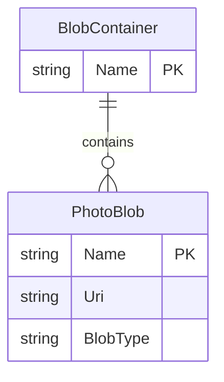

# Data Architecture & Persistence Layer

PhotoGallery has no relational database or ORM model. Its persistent data is a collection of photo blobs in a single Azure Blob Storage container.

## Database Configuration

| Service/Module | DB Type | Profile | Driver | Connection | Migration Tool |
|---|---|---|---|---|---|
| WebApp-Storage-DotNet | Azure Blob Storage object store | Application default | Azure.Storage.Blobs SDK 12.9.1 | `StorageConnectionString` is configured for the local development emulator | None |

No database schema, migration framework, or seed-data process is present. The blob container is created by the application when the gallery is loaded.

## Data Ownership per Service

| Service | Tables Owned | ORM Framework | Caching | Notes |
|---|---|---|---|---|
| WebApp-Storage-DotNet | None; owns photo blobs in the gallery container | None | None | Blob names are generated from a timestamp, GUID, and the uploaded file extension |

## Entity Model

The objects below are conceptual storage resources, not relational entities managed by an ORM.

## Key Repository Methods

| Service | Repository | Notable Methods | Purpose |
|---|---|---|---|
| WebApp-Storage-DotNet | No repository abstraction | `BlobContainerClient.GetBlobs()` | Lists objects in the gallery container |
| WebApp-Storage-DotNet | No repository abstraction | `BlobClient.UploadAsync(path)` | Uploads the selected file as a blob |
| WebApp-Storage-DotNet | No repository abstraction | `BlobClient.DeleteIfExistsAsync()` | Deletes one selected blob |
| WebApp-Storage-DotNet | No repository abstraction | `BlobContainerClient.DeleteBlobIfExistsAsync(name)` | Deletes each listed block blob |

## Caching Strategy

No application cache, cache provider, or cache annotations are configured.

## Data Ownership Boundaries

The single web application owns all gallery blobs and accesses them directly using the configured storage account. There are no other services, shared database, cross-service reads, or CQRS patterns. Blob URIs are returned to the view for display.

### Data Classification & Sensitivity

| Entity | Sensitive Fields | Classification (PII/PHI/PCI/None) | Controls in Place |
|---|---|---|---|
| PhotoBlob | Image content and blob URI | Potential PII, depending on uploaded photo | No application-level classification or masking; container is configured for public blob reads |

