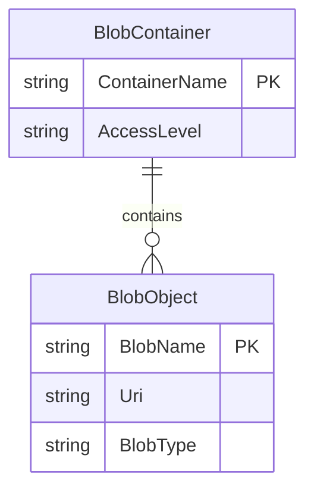

# Data Architecture & Persistence Layer

The application has no relational entities or ORM; its persisted data consists of image blobs in one Azure Blob Storage container. Blob names and URIs are used as the application-facing representation of stored images.

## Database Configuration

| Service/Module | DB Type | Profile | Driver | Connection | Migration Tool |
|---|---|---|---|---|---|
| WebApp-Storage-DotNet | Azure Blob Storage | Default configuration | Azure.Storage.Blobs 12.9.1 | `StorageConnectionString` app setting; default value selects local development storage | None |

No SQL database, schema migration, database seed, or relational schema configuration was found.

## Data Ownership per Service

| Service | Tables Owned | ORM Framework | Caching | Notes |
|---|---|---|---|---|
| WebApp-Storage-DotNet | None; owns objects in the configured image container | None | None | Application directly uses the Azure Blob SDK |

## Entity Model

The application has no local ORM entity model. The following is a logical representation of the object-storage boundary; it is not a relational database schema.

## Key Repository Methods

| Service | Repository | Notable Methods | Purpose |
|---|---|---|---|
| WebApp-Storage-DotNet | None | None | Storage operations are issued directly through `BlobContainerClient` and `BlobClient` in the controller. |

## Caching Strategy

No application cache provider, cache annotations, cache regions, TTL, or cache-aside pattern was found. Blob Storage is read directly when the gallery index action runs.

## Data Ownership Boundaries

There is one web application and one configured blob container; no cross-service data access, shared relational store, CQRS, or service-to-service aggregation was identified. The application is the only service-level owner shown in this repository, while Azure Blob Storage persists the image objects.

### Data Classification & Sensitivity

| Entity | Sensitive Fields | Classification (PII/PHI/PCI/None) | Controls in Place |
|---|---|---|---|
| BlobObject | Image content and blob URI; contents are not classified in code | Potentially sensitive user content | Container is configured for public blob reads; no application-level encryption, masking, or per-object authorization is configured. |
