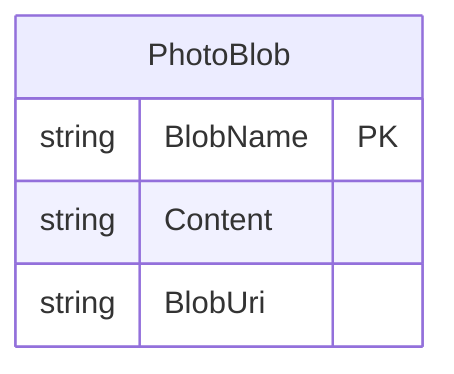

# Data Architecture & Persistence Layer

The application stores photo content in an Azure Blob Storage container and has no relational database, ORM, or application-owned entity model. Blob metadata and URIs are retrieved directly through the Azure Storage SDK.

## Database Configuration

| Service/Module | DB Type | Profile | Driver | Connection | Migration Tool |
|---|---|---|---|---|---|
| WebApp-Storage-DotNet | Azure Blob Storage | Default local development configuration | Azure.Storage.Blobs SDK 12.9.1 | `UseDevelopmentStorage=true` | None |

## Data Ownership per Service

| Service | Tables Owned | ORM Framework | Caching | Notes |
|---|---|---|---|---|
| WebApp-Storage-DotNet | None | None | None | Controller reads/writes photo blobs directly |
| Azure Blob Storage | Photo blobs and service metadata | Managed storage service | Not configured by application | Container is created on gallery access |

## Entity Model

`PhotoBlob` is a conceptual storage object represented by Azure blob metadata and a URI; it is not an application-defined entity class. No application-level relationships or foreign keys were found.

## Key Repository Methods

| Service | Repository | Notable Methods | Purpose |
|---|---|---|---|
| WebApp-Storage-DotNet | None | None | Storage access is performed directly by `HomeController` through Azure SDK clients |

## Caching Strategy

No application cache, cache provider, or cache policy was identified. The controller retrieves blob listings from storage when rendering the gallery.

## Data Ownership Boundaries

Photo content is owned by a single Azure Storage container. There is no shared database, database-per-service topology, cross-service query, CQRS flow, or application-level aggregation. The application directly lists and mutates the container.

### Data Classification & Sensitivity

| Entity | Sensitive Fields | Classification (PII/PHI/PCI/None) | Controls in Place |
|---|---|---|---|
| PhotoBlob | Photo content and blob URI | Potentially personal data depending on photo contents; no explicit PII/PHI/PCI fields modeled | Azure-managed encryption behavior is not configured in application files; container creation enables public blob reads |
