# Dependency Map

PhotoGallery is a legacy ASP.NET MVC application with 34 NuGet dependencies declared in `packages.config`. The map groups declared packages by their primary functional role.

## Dependencies

```mermaid
flowchart LR
    App["PhotoGallery"]

    subgraph Web["Web Frameworks and UI"]
        Bootstrap["bootstrap 3.0.0"]
        JQuery["jQuery 1.10.2"]
        JQueryValidation["jQuery.Validation 1.11.1"]
        MVC["Microsoft.AspNet.Mvc 5.2.3"]
        Razor["Microsoft.AspNet.Razor 3.2.3"]
        Optimization["Microsoft.AspNet.Web.Optimization 1.1.3"]
        WebPages["Microsoft.AspNet.WebPages 3.2.3"]
        Unobtrusive["Microsoft.jQuery.Unobtrusive.Validation 3.2.3"]
        Modernizr["Modernizr 2.6.2"]
        Respond["Respond 1.2.0"]
    end
    subgraph StorageData["Storage and Data"]
        AzureCore["Azure.Core 1.18.0"]
        Blob["Azure.Storage.Blobs 12.9.1"]
        AzureCommon["Azure.Storage.Common 12.8.0"]
        Edm["Microsoft.Data.Edm 5.6.4"]
        OData["Microsoft.Data.OData 5.6.4"]
        DataClient["Microsoft.Data.Services.Client 5.6.4"]
        Spatial["System.Spatial 5.6.4"]
    end
    subgraph Utilities["Utilities and Build"]
        Antlr["Antlr 3.4.1.9004"]
        AsyncInterfaces["Microsoft.Bcl.AsyncInterfaces 1.0.0"]
        CodeDom["Microsoft.CodeDom.Providers.DotNetCompilerPlatform 1.0.0"]
        Compilers["Microsoft.Net.Compilers 1.0.0"]
        WebInfrastructure["Microsoft.Web.Infrastructure 1.0.0.0"]
        JsonNet["Newtonsoft.Json 6.0.8"]
        Buffers["System.Buffers 4.5.1"]
        Diagnostics["System.Diagnostics.DiagnosticSource 4.6.0"]
        Memory["System.Memory 4.5.4"]
        MemoryData["System.Memory.Data 1.0.2"]
        Vectors["System.Numerics.Vectors 4.5.0"]
        Unsafe["System.Runtime.CompilerServices.Unsafe 4.6.0"]
        Encodings["System.Text.Encodings.Web 4.7.2"]
        SystemJson["System.Text.Json 4.6.0"]
        TaskExtensions["System.Threading.Tasks.Extensions 4.5.2"]
        ValueTuple["System.ValueTuple 4.5.0"]
        WebGrease["WebGrease 1.5.2"]
    end

    App -->|"web and UI"| Web
    App -->|"blob storage and data support"| StorageData
    App -->|"runtime utilities and build tools"| Utilities
```

### Dependency Summary

| Category | Count | Key Libraries | Notes |
|---|---:|---|---|
| Web Frameworks and UI | 10 | ASP.NET MVC 5.2.3, Razor 3.2.3, jQuery 1.10.2, Bootstrap 3.0.0 | Legacy ASP.NET MVC stack with older browser libraries |
| Storage and Data | 7 | Azure.Storage.Blobs 12.9.1, Azure.Core 1.18.0, Microsoft.Data.OData 5.6.4 | Azure Blob SDK plus legacy OData client dependencies |
| Utilities and Build | 17 | Newtonsoft.Json 6.0.8, System.Text.Json 4.6.0, Microsoft.Net.Compilers 1.0.0 | Compatibility libraries, utility packages, and compiler tooling |

### Version & Compatibility Risks

The application targets .NET Framework 4.8 and relies on the classic ASP.NET MVC 5 and `packages.config` model. Several dependencies are old, notably Newtonsoft.Json 6.0.8, jQuery 1.10.2, Bootstrap 3.0.0, and the Microsoft Data Services/OData 5.6.4 packages. Compatibility should be checked before upgrading because the project uses legacy web application build targets and explicit assembly references.

### Notable Observations

- The project declares 34 NuGet packages; `Microsoft.Net.Compilers` is marked as a development dependency.
- Both Newtonsoft.Json and System.Text.Json are present.
- Azure Blob Storage packages form the direct storage integration; no database or ORM package is declared.

## Test Dependencies

| Framework | Version | Notes |
|---|---|---|
| None detected | — | No test-scoped dependencies are declared in `packages.config` or the project file. |

Total test-scope dependencies: 0

No test dependencies are declared. No test project or test framework is configured in the solution.
