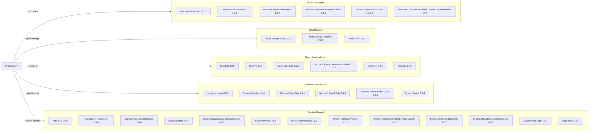

# Dependency Map

PhotoGallery declares 34 NuGet packages in `WebApp-Storage-DotNet/packages.config`. The dependency list reflects declared versions; resolution of transitive packages was unavailable because the legacy WebApplication MSBuild targets are missing on this runner.

## Dependencies

### Dependency Summary

| Category | Count | Key Libraries | Notes |
|---|---:|---|---|
| Web Frameworks | 6 | ASP.NET MVC 5.2.3, Razor 3.2.3 | Legacy .NET Framework MVC stack |
| Cloud Storage | 3 | Azure.Storage.Blobs 12.9.1 | External object storage integration |
| Client UI and Validation | 6 | Bootstrap 3.0.0, jQuery 1.10.2 | Legacy browser libraries |
| Data and Serialization | 6 | Newtonsoft.Json 6.0.8, System.Text.Json 4.6.0 | JSON and OData support |
| Runtime Support | 13 | System.Memory, System.Buffers, WebGrease | Compatibility and compiler/runtime support |

### Version & Compatibility Risks

The application targets .NET Framework 4.8 and uses an older MVC 5 stack. Several client libraries and JSON packages are old; the dependency scan found known advisories affecting declared package versions. The full transitive dependency graph could not be resolved on this Linux runner because Visual Studio WebApplication MSBuild targets are unavailable.

### Notable Observations

- Both Newtonsoft.Json and System.Text.Json are declared.
- Microsoft.Net.Compilers and the CodeDom provider are old build-time compiler dependencies.
- No test-scoped packages are declared in `packages.config`.

## Test Dependencies

| Framework | Version | Notes |
|---|---|---|
| None detected | — | No test-scoped packages or test project found |

Total test-scope dependencies: 0

No test dependencies were detected in the solution.
