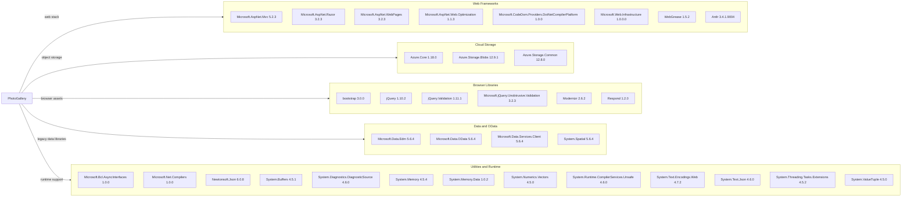

# Dependency Map

PhotoGallery declares 34 NuGet dependencies in `WebApp-Storage-DotNet/packages.config`; no lock file is present to resolve a transitive dependency tree.

## Dependencies

### Dependency Summary

| Category | Count | Key Libraries | Notes |
|---|---:|---|---|
| Web Frameworks | 8 | ASP.NET MVC, Razor, WebPages | Legacy ASP.NET MVC 5 stack |
| Cloud Storage | 3 | Azure.Storage.Blobs, Azure.Core | Azure object storage integration |
| Browser Libraries | 6 | jQuery, Bootstrap, jQuery.Validation | Older client-side dependencies |
| Data and OData | 4 | Microsoft.Data.OData, Microsoft.Data.Edm | Legacy OData client stack |
| Utilities and Runtime | 13 | Newtonsoft.Json, System.Memory, System.Text.Json | Includes runtime support and compiler tooling |

### Version & Compatibility Risks

The project targets .NET Framework 4.8 and depends on older MVC, browser, and OData libraries. The dependency assessment found high-severity advisories affecting jQuery.Validation 1.11.1, Microsoft.Data.OData 5.6.4, and Newtonsoft.Json 6.0.8; the detailed findings are in `security-assessment.md`.

### Notable Observations

- `Microsoft.Net.Compilers` is marked as a development dependency; it is not a test framework.
- Both Newtonsoft.Json and System.Text.Json are declared.
- Dependency-tree collection could not load the legacy project because Visual Studio WebApplication targets are absent in this Linux environment; the inventory reflects `packages.config` declarations.

## Test Dependencies

| Framework | Version | Notes |
|---|---|---|
| None detected | — | No test-scoped packages are declared in `packages.config`. |

Total test-scope dependencies: 0

No test dependencies or test infrastructure are declared in the project package manifest.
