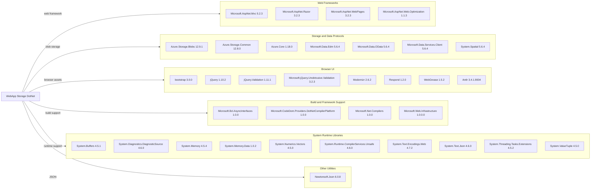

# Dependency Map

The `WebApp-Storage-DotNet` project declares 34 NuGet packages in `packages.config`; the map summarizes the external libraries used by the single web application.

## Dependencies

### Dependency Summary

| Category | Count | Key Libraries | Notes |
|---|---:|---|---|
| Web Frameworks | 4 | ASP.NET MVC 5.2.3, Razor 3.2.3 | Legacy System.Web stack |
| Storage and Data Protocols | 7 | Azure Storage Blobs 12.9.1, Azure.Core 1.18.0 | Azure Blob client and supporting protocol packages |
| Browser UI | 8 | jQuery 1.10.2, Bootstrap 3.0.0 | Older client-side libraries and validation |
| Build and Framework Support | 4 | CodeDom provider 1.0.0 | Includes the development-only compiler package |
| System Runtime Libraries | 10 | System.Memory 4.5.4, System.Text.Json 4.6.0 | Compatibility libraries for .NET Framework |
| Other Utilities | 1 | Newtonsoft.Json 6.0.8 | Legacy JSON library |

### Version & Compatibility Risks

The project targets .NET Framework 4.8 and uses ASP.NET MVC 5, while several NuGet packages are old, including Newtonsoft.Json 6.0.8, jQuery 1.10.2, and the 1.0.0 compiler tooling. Moving to modern .NET requires replacing the System.Web MVC hosting model and reviewing package compatibility; the current package inventory could not be resolved transitively because the legacy project requires Visual Studio Web Application targets unavailable in this Linux environment.

### Notable Observations

- No central package management or lock file is present; versions are declared in `packages.config`.
- `Azure.Storage.Blobs` is the principal data integration and pulls supporting Azure and data-protocol libraries.
- The project declares both Newtonsoft.Json and System.Text.Json assemblies, although no application-level JSON serialization usage was identified.
- No test dependencies are declared.

## Test Dependencies

| Framework | Version | Notes |
|---|---|---|
| None detected | — | No test project or test-scoped NuGet package is present in the solution. |

Total test-scope dependencies: 0

No test dependencies detected.
