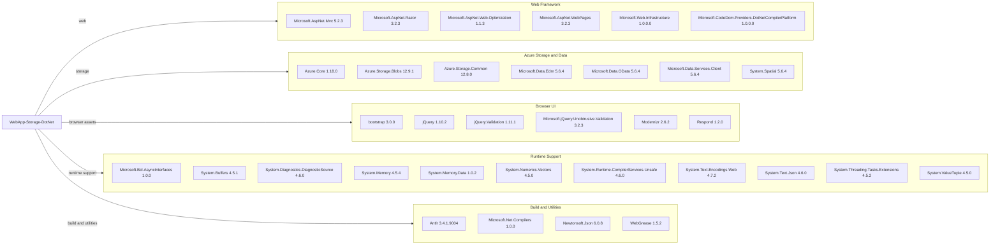

# Dependency Map

The WebApp-Storage-DotNet project declares 34 NuGet packages in `packages.config`. The package CLI could not load the legacy web project on Linux, so this inventory reflects declared package versions and does not include a resolved transitive tree.

## Dependencies

### Dependency Summary

| Category | Count | Key Libraries | Notes |
|---|---:|---|---|
| Web Framework | 6 | ASP.NET MVC, Razor, WebPages, Web Optimization | Classic `System.Web` MVC stack |
| Azure Storage and Data | 7 | Azure.Storage.Blobs, Azure.Core, Azure.Storage.Common | Blob storage SDK plus legacy OData-related packages |
| Browser UI | 6 | Bootstrap, jQuery, jQuery Validation | Browser libraries are substantially dated |
| Runtime Support | 11 | System.Memory, System.Text.Json, System.Buffers | Compatibility libraries declared for .NET Framework |
| Build and Utilities | 4 | Newtonsoft.Json, Microsoft.Net.Compilers, Antlr, WebGrease | Includes an old compiler package and JSON library |

### Version & Compatibility Risks

The package set contains multiple known vulnerable versions: `Microsoft.Data.OData` 5.6.4, jQuery Validation 1.11.1, Newtonsoft.Json 6.0.8, Bootstrap 3.0.0, jQuery 1.10.2, and Azure.Storage.Blobs 12.9.1. The separate advisory report records the applicable GitHub Security Advisories and patched versions. The project targets .NET Framework 4.8 and uses legacy non-SDK project infrastructure, which limits modern cross-platform build and upgrade tooling.

### Notable Observations

- Dependency resolution could not run because `Microsoft.WebApplication.targets` is unavailable in the Linux environment; transitive dependency coverage is therefore incomplete.
- The app's storage behavior is built around Azure Blob Storage rather than a relational database or ORM.
- No test-scoped package dependencies are declared.
- The project references both Newtonsoft.Json and System.Text.Json packages.

## Test Dependencies

| Framework | Version | Notes |
|---|---|---|
| None detected | — | No test-scoped packages are declared in `packages.config`. |

Total test-scope dependencies: 0

No test dependencies or test project were detected in the solution.
