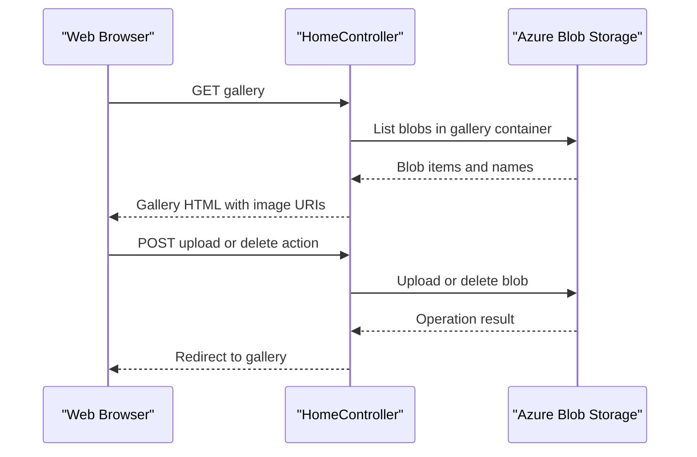

# API & Service Communication Contracts

The application exposes four MVC actions through one web service and uses synchronous HTTP form submissions for browser interactions. It has no separate internal service APIs or asynchronous messaging.

## Service Catalog

| Service | Port | Category | Purpose |
|---|---|---|---|
| WebApp-Storage-DotNet | Not specified in application configuration | API Layer | Renders the gallery and handles upload and deletion requests |
| Azure Blob Storage | Azure-managed endpoint | Infrastructure | Stores and serves gallery blobs |

## API Endpoints Inventory

The MVC default route is `/{controller}/{action}/{id}` with `Home/Index` as its default.

| Service | Method | Path | Request Type | Response Type |
|---|---|---|---|---|
| WebApp-Storage-DotNet | GET | `/` or `/Home/Index` | No body | Gallery HTML containing blob URIs, or error view |
| WebApp-Storage-DotNet | POST | `/Home/UploadAsync` | Multipart form files | Redirect to `Home/Index`, or error view |
| WebApp-Storage-DotNet | POST | `/Home/DeleteImage` | Form parameter `Name` containing blob URI/name | Redirect to `Home/Index`, or error view |
| WebApp-Storage-DotNet | POST | `/Home/DeleteAll` | No body | Redirect to `Home/Index`, or error view |

No explicit API versioning, REST DTOs, or JSON response contracts are declared.

## Management & Observability Endpoints

| Service | Endpoint | Custom Metrics |
|---|---|---|
| WebApp-Storage-DotNet | None detected | None detected |

## DTOs & Contracts

No custom request or response DTOs are present. The upload action consumes ASP.NET’s multipart request file collection; the index action passes a list of blob `Uri` values to the view. The application uses the Azure SDK’s `BlobItem` and `BlobClient` types internally. No OpenAPI, protobuf, or GraphQL contract was found. JSON serialization is not part of the application’s exposed action contract.

## Communication Patterns

Browser-to-application communication is synchronous HTTP using MVC form submissions and redirects. The controller invokes the Azure Blob Storage SDK for listing, upload, and deletion; SDK storage operations use Azure service requests. There is no message broker, service discovery, gateway aggregation, configured retry/circuit breaker policy, or client-side load balancing in the application. The configured connection string chooses the storage endpoint. No application-level authentication, authorization, or TLS policy is configured in the project; transport security can be supplied by the hosting environment.

## Service Technology Matrix

| Service | Web | Data Access | Discovery | Gateway | Actuator | Cache | Metrics |
|---|---|---|---|---|---|---|---|
| WebApp-Storage-DotNet | ASP.NET MVC 5 | Azure Storage SDK | None | None | None | None | None |
| Azure Blob Storage | Azure service API | Blob Storage | Azure-managed endpoint | N/A | Azure-managed | N/A | Azure-managed |

## Service Communication Sequence

