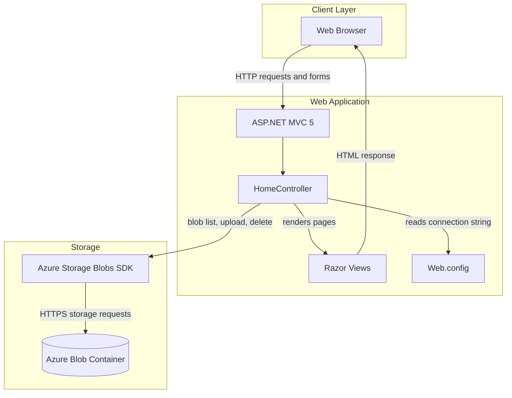
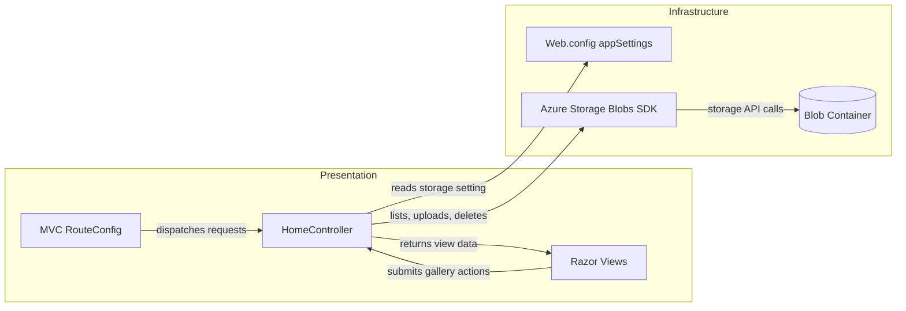

# Architecture Diagram

This application is a single web application that serves a photo gallery and stores its image content in Azure Blob Storage. The browser communicates with MVC actions, which use the Azure Storage SDK directly.

## Application Architecture

### Technology Stack Summary

| Layer | Technology | Version | Purpose |
|---|---|---:|---|
| Presentation | ASP.NET MVC | 5.2.3 | Routes browser requests and renders Razor pages |
| Runtime | .NET Framework | 4.8 | Hosts the application |
| View | Razor | 3.2.3 | Produces gallery and error pages |
| Storage | Azure.Storage.Blobs | 12.9.1 | Lists, uploads, and deletes blobs |
| Storage client core | Azure.Core | 1.18.0 | Provides Azure SDK client infrastructure |

### Data Storage & External Services

The application persists images in one Azure Blob Storage container named `webappstoragedotnet-imagecontainer`. The configured development default uses the local Azure Storage emulator; a deployed environment requires a storage-account connection string. No relational database, cache, message broker, or other external service is configured.

### Key Architectural Decisions

- Uses a single MVC controller to implement gallery listing, upload, and deletion.
- Accesses Azure Blob Storage directly through its SDK rather than through a separate repository or service layer.
- Stores images as blobs and exposes their URIs to the browser.

## Component Relationships

### Component Inventory

| Component | Layer | Type | Responsibility |
|---|---|---|---|
| RouteConfig | Presentation | MVC routing configuration | Maps the default route to `Home/Index` |
| HomeController | Presentation | MVC controller | Lists, uploads, and deletes gallery blobs |
| Razor Views | Presentation | MVC views | Render the gallery and error details |
| Web.config | Infrastructure | Application configuration | Supplies the storage connection string and web runtime settings |
| Azure Storage Blobs SDK | Infrastructure | External client library | Communicates with the configured blob service |
| Azure Blob Container | Storage | Object storage | Stores gallery images |
