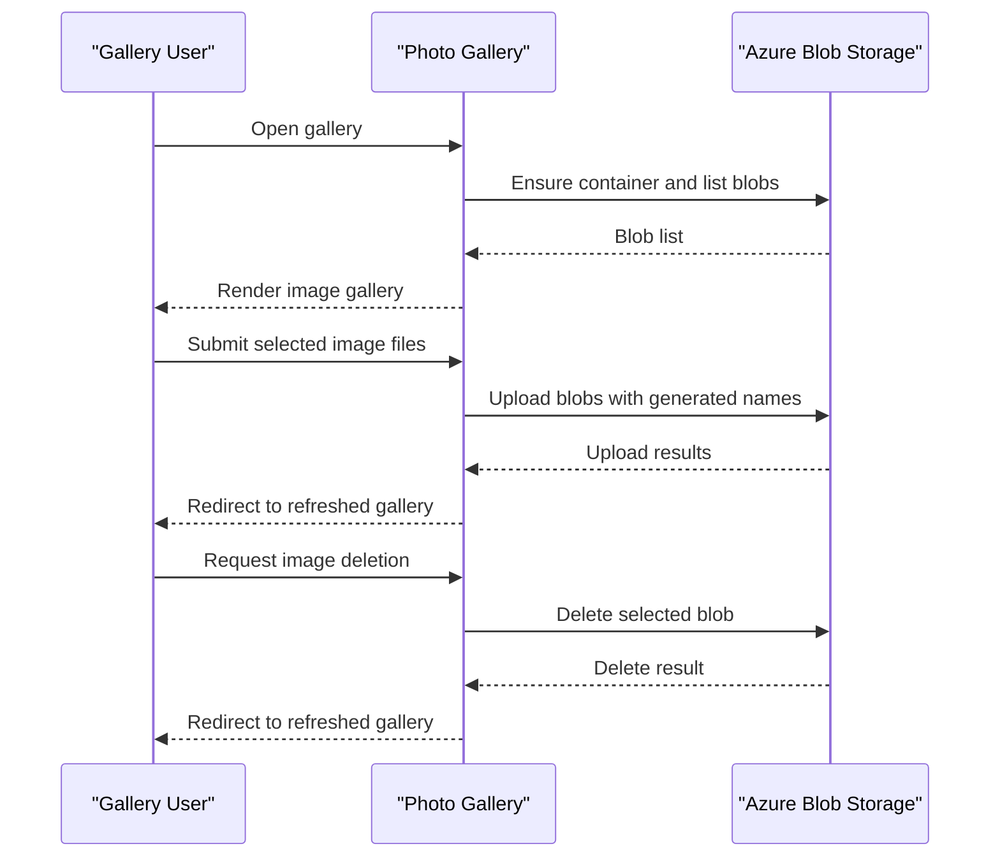

# Core Business Workflows

The application lets users browse a photo gallery backed by blob storage, upload image files, and delete individual or all stored blobs. No additional domain services or multi-service business process is present.

## Domain Entities

| Entity | Service / Bounded Context | Description | Key Relationships |
|---|---|---|---|
| Gallery Blob | WebApp-Storage-DotNet / Photo Gallery | An uploaded object displayed as a gallery image | Belongs to the configured blob container |
| Blob Container | Azure Blob Storage / Image Storage | Holds the gallery’s stored objects | Contains gallery blobs |

## Service-to-Domain Mapping

| Service | Domain Context | Owned Entities | External Dependencies |
|---|---|---|---|
| WebApp-Storage-DotNet | Photo Gallery | Gallery view and blob operations | Azure Blob Storage |
| Azure Blob Storage | Image Storage | Blob objects and container | None identified |

There are no cross-service domain exchanges; the web application directly invokes the storage service.

## Primary Workflows

### Workflow 1: Browse the Gallery

1. The browser requests the default `Home/Index` page.
2. The controller creates the container if it does not exist and lists the container’s block blobs.
3. The controller converts blob names to URIs and passes the list to the Razor view.
4. The view renders links and thumbnails for each URI.

### Workflow 2: Upload Images

1. The user selects files and submits a multipart form to `Home/UploadAsync`.
2. The controller iterates over the submitted files and generates a unique blob name using the current tick count, a GUID, and the original extension.
3. The file is uploaded to the configured container.
4. The controller redirects the browser to the gallery.

### Workflow 3: Delete Images

The browser posts a selected blob URI to `Home/DeleteImage`; the controller extracts its file name, deletes that blob if it exists, and redirects to the gallery. `Home/DeleteAll` iterates through block blobs in the container, deletes them, and redirects.

## Cross-Service Data Flows

The web application calls Azure Blob Storage directly to create the container, enumerate blobs, upload files, and delete blobs. The gallery view receives blob URIs for display. There is no aggregation across multiple services or fallback behavior for a downstream service outage; storage exceptions are rendered using the error view.

## Business Workflow Sequence

## Business Rules & Decision Logic

- Only blobs whose storage type is `Block` are included in gallery listing and bulk deletion.
- New blob names are generated using a timestamp and GUID while retaining the selected file extension.
- Individual deletion extracts a file name from the submitted URI and uses `DeleteIfExistsAsync`; bulk deletion processes each block blob.
- No application-level authentication, authorization, input validation, upload-type allowlist, or audit trail is implemented.
- Storage exceptions are caught and rendered in the error view; no compensating action or business transaction is present.
