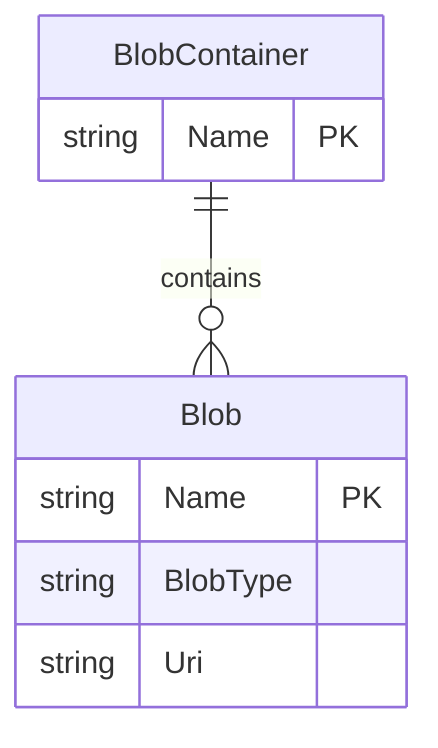

# Data Architecture & Persistence Layer

The application has no relational database, ORM entities, or repository interfaces. Its persisted data consists of image blobs in a single Azure Blob Storage container.

## Database Configuration

| Service/Module | DB Type | Profile | Driver | Connection | Migration Tool |
|---|---|---|---|---|---|
| WebApp-Storage-DotNet | Azure Blob Storage | Default local development | Azure.Storage.Blobs SDK 12.9.1 | `UseDevelopmentStorage=true` | None |
| WebApp-Storage-DotNet | Azure Blob Storage | Deployment | Azure Blob Storage | `StorageConnectionString` must be replaced with the account connection string | None |

The application creates the container if it does not exist. No relational schema, migrations, or seed data are configured.

## Data Ownership per Service

| Service | Tables Owned | ORM Framework | Caching | Notes |
|---|---|---|---|---|
| WebApp-Storage-DotNet | Blobs in `webappstoragedotnet-imagecontainer` | None; Azure Storage SDK | None | The application writes and deletes block blobs |

## Entity Model

There are no relational entities. The storage concepts can be summarized as:

## Key Repository Methods

| Service | Repository | Notable Methods | Purpose |
|---|---|---|---|
| WebApp-Storage-DotNet | None | None | Storage operations are issued directly from `HomeController` through Azure SDK clients |

## Caching Strategy

No application-level cache, cache provider, or cache policy was found.

## Data Ownership Boundaries

The single application owns access to one Azure Blob Storage container; there are no service-to-service database boundaries or cross-service data access flows. The controller obtains blob references from the container and returns their URIs to the browser. This is a direct object-storage access pattern rather than a CQRS or shared relational database design.

### Data Classification & Sensitivity

| Entity | Sensitive Fields | Classification (PII/PHI/PCI/None) | Controls in Place |
|---|---|---|---|
| Blob | Arbitrary uploaded image content and blob name | Unknown; uploaded content may include personal data | No application-level classification or field-level controls detected; container is configured for public blob reads |

