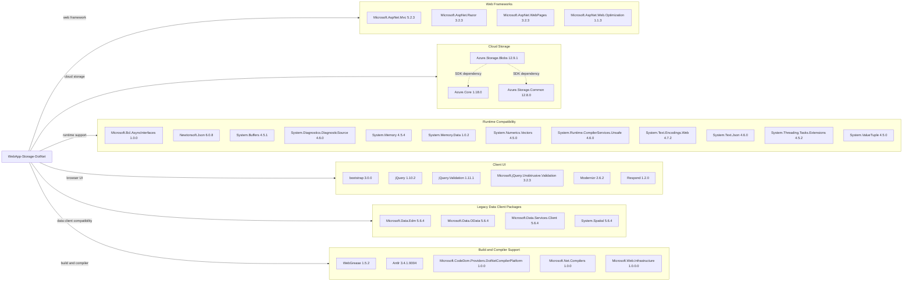

# Dependency Map

The `WebApp-Storage-DotNet` project declares 34 packages in `packages.config`. This map focuses on the direct NuGet package declarations; the project uses legacy package references rather than a lock file.

## Dependencies

### Dependency Summary

| Category | Count | Key Libraries | Notes |
|---|---:|---|---|
| Web Frameworks | 4 | ASP.NET MVC 5.2.3, Razor 3.2.3, WebPages 3.2.3 | Classic ASP.NET MVC stack |
| Cloud Storage | 3 | Azure.Storage.Blobs 12.9.1, Azure.Core 1.18.0 | Azure SDK is the application’s persistence client |
| Runtime Compatibility | 12 | Newtonsoft.Json 6.0.8, System.Memory 4.5.4, System.Text.Json 4.6.0 | Includes compatibility packages for .NET Framework |
| Client UI | 6 | Bootstrap 3.0.0, jQuery 1.10.2, jQuery.Validation 1.11.1 | Legacy browser assets |
| Legacy Data Client Packages | 4 | Microsoft.Data.Edm 5.6.4, Microsoft.Data.OData 5.6.4, System.Spatial 5.6.4 | Declared packages; no corresponding relational data layer is used by this app |
| Build and Compiler Support | 5 | WebGrease 1.5.2, Antlr 3.4.1.9004, CodeDom provider 1.0.0 | Build, bundling, and compiler support |

### Version & Compatibility Risks

The application targets .NET Framework 4.8 and uses older MVC, Razor, JSON, jQuery, and Bootstrap package versions. The legacy non-SDK project format and Visual Studio Web Application targets also constrain cross-platform builds and modernization to newer .NET versions.

### Notable Observations

- `packages.config` lists 34 package declarations; all 34 are shown in the diagram. No test-scoped dependencies or package lock file were found.
- Azure Blob Storage is the only application-specific persistence dependency.
- Legacy jQuery 1.10.2, Bootstrap 3.0.0, and Newtonsoft.Json 6.0.8 are notable modernization and maintenance risks.

## Test Dependencies

| Framework | Version | Notes |
|---|---|---|
| None detected | — | No test project or test-scoped package declarations were found. |

Total test-scope dependencies: 0

No test dependencies detected.
