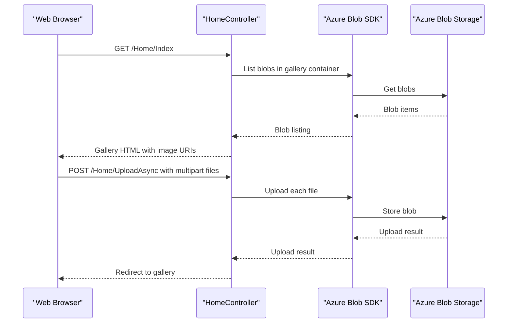

# API & Service Communication Contracts

The application exposes four conventional MVC actions: one gallery page and three form actions for upload and deletion. Communication is synchronous HTTP between browser and application, followed by direct calls to the blob storage service.

## Service Catalog

| Service | Port | Category | Purpose |
|---|---:|---|---|
| WebApp-Storage-DotNet | 20050 (local IIS Express setting) | API Layer | Serves the gallery page and handles image upload and deletion |
| Azure Blob Storage | Configured by storage connection string | Infrastructure | Stores and returns image blobs |

## API Endpoints Inventory

| Service | Method | Path | Request Type | Response Type |
|---|---|---|---|---|
| WebApp-Storage-DotNet | GET | `/Home/Index` (default route `/`) | No body | Gallery HTML; error view on failure |
| WebApp-Storage-DotNet | POST | `/Home/UploadAsync` | Multipart form files | Redirect to `/Home/Index`; error view on failure |
| WebApp-Storage-DotNet | POST | `/Home/DeleteImage` | Form parameter `Name` containing the blob URI | Redirect to `/Home/Index`; error view on failure |
| WebApp-Storage-DotNet | POST | `/Home/DeleteAll` | Form submission | Redirect to `/Home/Index`; error view on failure |

The default MVC route is `{controller}/{action}/{id}`, with `Home/Index` as its default. No API versioning scheme is configured.

## Management & Observability Endpoints

| Service | Endpoint | Custom Metrics |
|---|---|---|
| WebApp-Storage-DotNet | None identified | None identified |

## DTOs & Contracts

No dedicated request or response DTO classes, OpenAPI specification, protobuf schema, or GraphQL schema are declared. The gallery action passes a `List<Uri>` as its view model; upload uses the MVC request file collection, and delete accepts a form parameter. No immutable DTO contracts are present. The application uses MVC/Razor view rendering rather than a separately documented JSON API.

## Communication Patterns

Browser requests and controller responses use synchronous HTTP. The controller makes asynchronous SDK calls for upload and deletion, and synchronously enumerates blobs for gallery listing and bulk deletion. There are no additional application services, API gateway, message broker, service discovery, client-side load balancing, explicit retry policy, circuit breaker, or fallback policy identified. The application configuration does not define API-level authentication, authorization, or TLS; these controls are not established by the inspected project configuration.

## Service Technology Matrix

| Service | Web | Data Access | Discovery | Gateway | Actuator | Cache | Metrics |
|---|---|---|---|---|---|---|---|
| WebApp-Storage-DotNet | ASP.NET MVC 5 | Azure Blob Storage SDK | None | None | None | None | None |
| Azure Blob Storage | Blob service API | Blob storage | Azure endpoint from connection string | — | — | — | — |

## Service Communication Sequence

