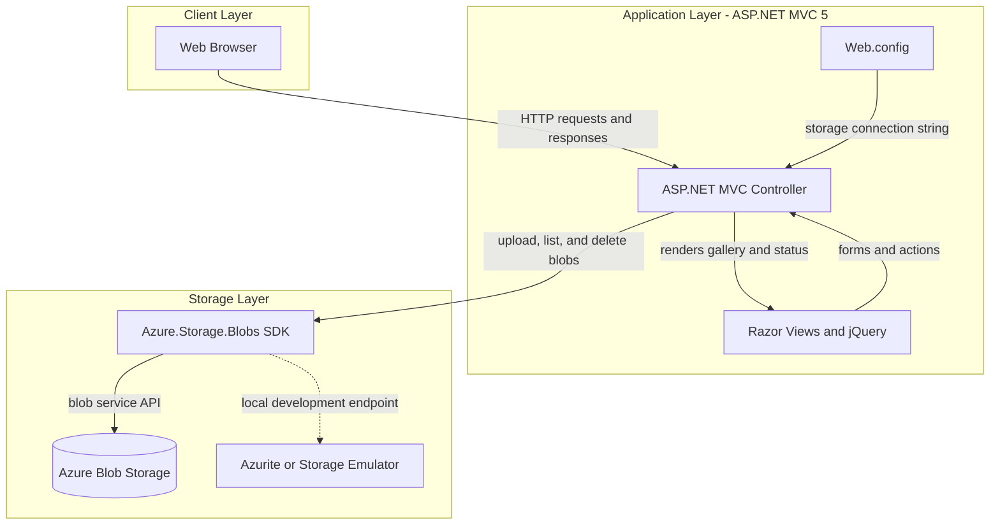
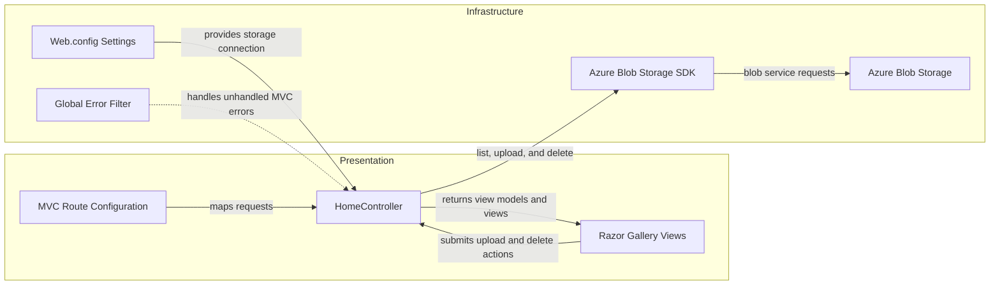

# Architecture Diagram

The application is a server-rendered ASP.NET MVC photo gallery. It stores image blobs in Azure Blob Storage and has no relational database or separate service tier.

## Application Architecture

### Technology Stack Summary

| Layer | Technology | Version | Purpose |
|---|---|---|---|
| Presentation | ASP.NET MVC | 5.2.3 | Routes web requests and renders server-side Razor views |
| Web runtime | .NET Framework | 4.8 | Hosts the application on IIS |
| Browser UI | Razor, jQuery, Bootstrap | jQuery 1.10.2; Bootstrap 3.0.0 | Displays the gallery and provides upload/delete controls |
| Object storage | Azure.Storage.Blobs | 12.9.1 | Persists and serves image blobs |
| Configuration | Web.config | — | Provides the storage connection setting and ASP.NET runtime settings |

### Data Storage & External Services

Images are stored as block blobs in an Azure Blob Storage container named `webappstoragedotnet-imagecontainer`. The sample configures `UseDevelopmentStorage=true`, indicating a local storage emulator endpoint for development; no database, cache, message broker, or other external API is evident.

### Key Architectural Decisions

- MVC routes, controller actions, and Razor views are combined in a single web application.
- The controller directly uses the Azure Blob Storage SDK; a separate service or repository layer is not present.
- Blob storage is the durable data store, and the application lists, uploads, and deletes blobs through the storage client.

## Component Relationships

### Component Inventory

| Component | Layer | Type | Responsibility |
|---|---|---|---|
| RouteConfig | Presentation | MVC route configuration | Maps incoming requests to controller actions |
| HomeController | Presentation | MVC controller | Lists, uploads, and deletes gallery blobs |
| Index.cshtml | Presentation | Razor view | Displays images and submits gallery actions |
| MvcApplication | Infrastructure | ASP.NET application startup | Registers routes, filters, and bundles |
| FilterConfig | Infrastructure | MVC filter configuration | Registers the global error handler |
| Web.config | Infrastructure | Application configuration | Defines runtime settings and storage connection string |
| Azure.Storage.Blobs SDK | Infrastructure | Storage client library | Communicates with blob storage |
