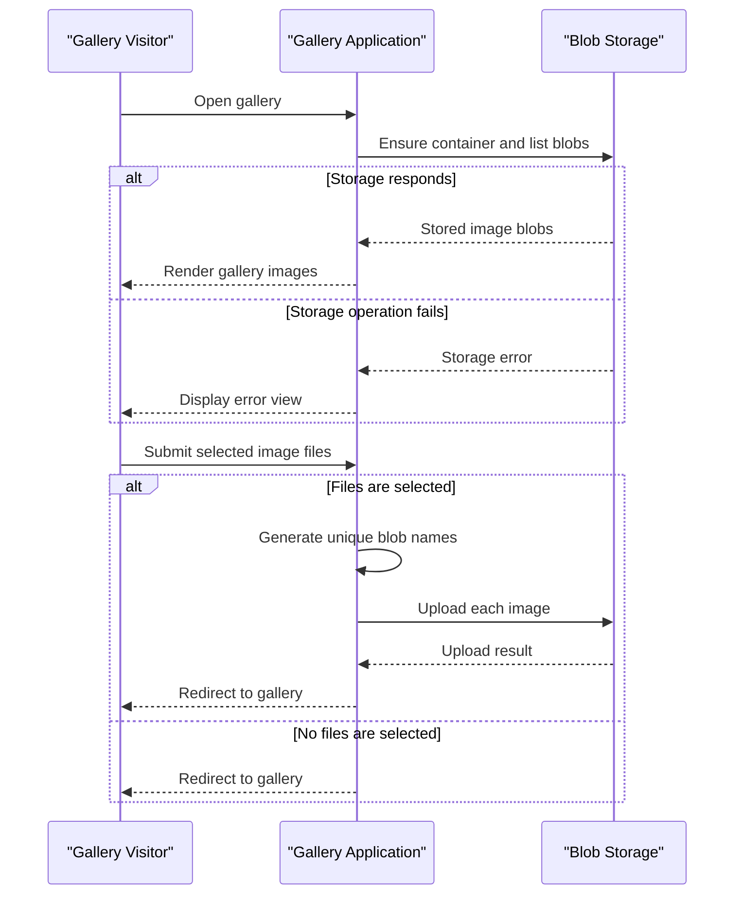

# Core Business Workflows

The application provides a simple photo gallery for browsing, uploading, and removing images. Gallery items are represented by image blobs, with Azure Blob Storage as the source of truth.

## Domain Entities

| Entity | Service / Bounded Context | Description | Key Relationships |
|---|---|---|---|
| Gallery | WebApp-Storage-DotNet / Photo Gallery | A user-facing collection of stored images | Contains image blobs |
| Image Blob | WebApp-Storage-DotNet / Photo Gallery | An image object available for display or removal | Belongs to the gallery container |

## Service-to-Domain Mapping

| Service | Domain Context | Owned Entities | External Dependencies |
|---|---|---|---|
| WebApp-Storage-DotNet | Photo Gallery | Gallery interactions and image blob naming | Azure Blob Storage |

## Primary Workflows

### Workflow 1: Browse the Gallery

1. A visitor requests the gallery page.
2. The application initializes the configured blob container if needed and lists its blobs.
3. The application selects block blobs, converts them to image URIs, and renders the gallery.
4. If storage access fails, the application displays its error view.

### Workflow 2: Upload Images

1. A visitor selects one or more files and submits the upload form.
2. The application checks whether the request contains files.
3. For each file, it creates a unique blob name from the current tick count, a GUID, and the original extension, then uploads it.
4. The visitor is redirected to the gallery after completion; an exception displays the error view.

### Workflow 3: Remove Images

1. A visitor submits a delete action for one image or all images.
2. The application derives the blob name from the supplied image URI for a single deletion, or iterates through the container for bulk deletion.
3. Only block blobs are selected for bulk deletion; individual deletion uses delete-if-present behavior.
4. The visitor is redirected to the gallery after completion; an exception displays the error view.

## Cross-Service Data Flows

There is no service-to-service composition. The web application is the only application service and directly reads and mutates blob data in Azure Blob Storage. No fallback data source or degraded cross-service response is configured.

## Business Workflow Sequence

## Business Rules & Decision Logic

- Only block blobs are included in the gallery and in the bulk-delete operation.
- Each uploaded object receives a generated name using timestamp ticks and a GUID, while retaining the source file extension.
- Single-image deletion is conditional on the blob existing; bulk deletion visits blobs in the container.
- No file-type, content, size, or user-authorization business checks are evident in the inspected workflow. No transaction, audit trail, or multi-service consistency mechanism is configured.
