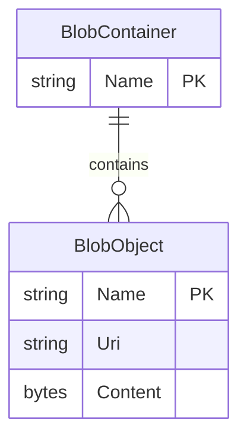

# Data Architecture & Persistence Layer

The application persists gallery images as Azure Blob Storage objects and defines no relational entities, ORM context, or repository layer. Its application-level data model is limited to blob identifiers and URIs used to display and manage stored images.

## Database Configuration

| Service/Module | DB Type | Profile | Driver | Connection | Migration Tool |
|---|---|---|---|---|---|
| WebApp-Storage-DotNet | Azure Blob object storage; no relational database identified | Single configuration; local storage emulator is the sample default | Azure.Storage.Blobs SDK | Read from application configuration; endpoint/account details are environment-configurable | None identified |

## Data Ownership per Service

| Service | Tables Owned | ORM Framework | Caching | Notes |
|---|---|---|---|---|
| WebApp-Storage-DotNet | No relational tables; image blobs in the gallery container | None | None identified | Application lists, uploads, and deletes block blobs using the Azure SDK |

## Entity Model

The project contains no application-defined persistence entities or relational mappings. This diagram represents the conceptual Azure Blob Storage objects accessed by the code, not a relational schema.

## Key Repository Methods

| Service | Repository | Notable Methods | Purpose |
|---|---|---|---|
| WebApp-Storage-DotNet | None identified | None | Storage operations are called directly through the Azure Blob SDK from the controller; no repository abstraction is present |

## Caching Strategy

No application-level cache provider, cache configuration, or caching pattern was identified. The gallery enumerates blobs from storage when requested.

## Data Ownership Boundaries

The application accesses a single Azure Blob Storage container and has no separate database or multi-service data boundary. The controller directly performs storage operations through the Azure SDK; there is no cross-service data access or CQRS pattern identified.

### Data Classification & Sensitivity

| Entity | Sensitive Fields | Classification (PII/PHI/PCI/None) | Controls in Place |
|---|---|---|---|
| BlobObject | Image content may contain personal or other sensitive information; contents are not classified in source | Potential PII or other sensitive content; not determinable from the model | No application-level field encryption or masking is documented; storage-service encryption controls are outside the inspected project configuration |

