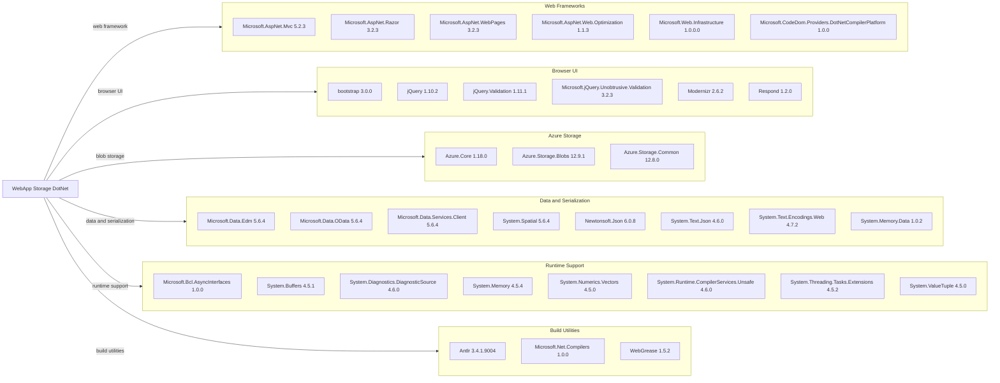

# Dependency Map

The WebApp-Storage-DotNet application declares 34 NuGet packages in its legacy `packages.config` file. The project also uses .NET Framework and ASP.NET framework assemblies supplied by the target platform.

## Dependencies

### Dependency Summary

| Category | Count | Key Libraries | Notes |
|---|---:|---|---|
| Web Frameworks | 6 | ASP.NET MVC 5.2.3, Razor 3.2.3, WebPages 3.2.3 | Legacy ASP.NET MVC stack |
| Browser UI | 6 | jQuery 1.10.2, Bootstrap 3.0.0 | Browser-side libraries declared in NuGet |
| Azure Storage | 3 | Azure.Storage.Blobs 12.9.1 | Azure SDK packages for blob operations |
| Data and Serialization | 8 | Microsoft OData 5.6.4, Newtonsoft.Json 6.0.8 | Includes legacy OData packages and two JSON libraries |
| Runtime Support | 8 | System.Memory 4.5.4, System.Text.Encodings.Web 4.7.2 | Compatibility packages for .NET Framework |
| Build Utilities | 3 | Microsoft.Net.Compilers 1.0.0, WebGrease 1.5.2 | Includes development compiler tooling |

### Version & Compatibility Risks

The application targets .NET Framework 4.8 and uses ASP.NET MVC 5.2.3; this is a legacy, Windows/IIS-oriented stack rather than an ASP.NET Core application. Several declared browser and serialization dependencies are old, including jQuery 1.10.2, Newtonsoft.Json 6.0.8, and Microsoft.Net.Compilers 1.0.0. Migration compatibility should be assessed package by package, especially for the legacy OData libraries.

### Notable Observations

- The package manifest declares six browser-facing packages, including older jQuery and Bootstrap releases.
- Both Newtonsoft.Json and System.Text.Json are declared; the project may carry overlapping serialization capabilities.
- Microsoft.Data.Edm, Microsoft.Data.OData, Microsoft.Data.Services.Client, and System.Spatial form an older OData-related dependency group.
- No central package management file, lock file, or test-scoped package dependency is present.

## Test Dependencies

No test dependencies detected.

Total test-scope dependencies: 0

No test framework or test-specific package is declared in the project package manifest.
