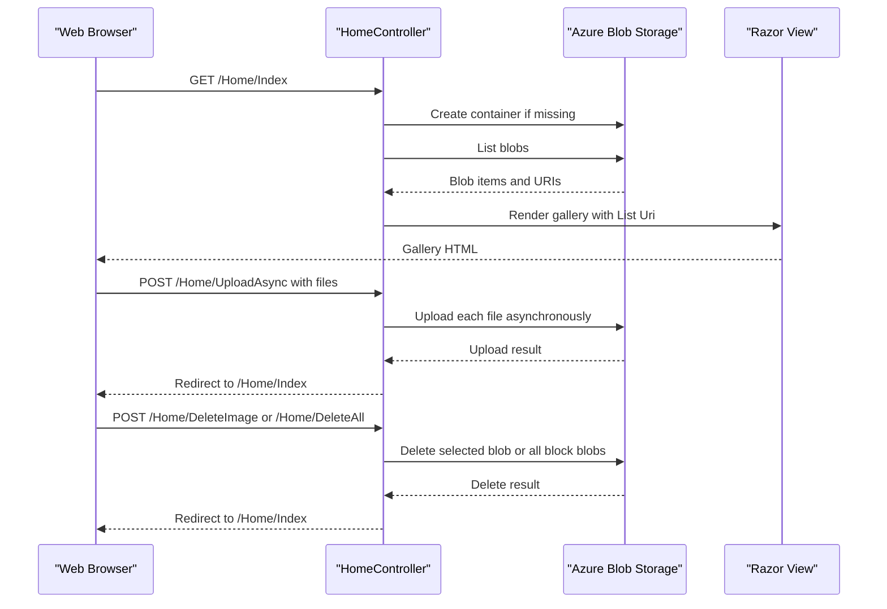

# API & Service Communication Contracts

The application exposes four MVC action endpoints for viewing, uploading, and deleting gallery images. Requests are handled synchronously at the HTTP boundary, with asynchronous calls to Azure Blob Storage for writes and deletes.

## Service Catalog

| Service | Port | Category | Purpose |
|---|---|---|---|
| WebApp-Storage-DotNet | Not configured in application files | API Layer | Serves the photo gallery and performs image operations against Blob Storage |
| Azure Blob Storage | External service | Infrastructure | Persists gallery image blobs |

## API Endpoints Inventory

The MVC default route is `/{controller}/{action}/{id}`, with `Home/Index` as its default. Parameters not mapped to the route can be supplied through MVC model binding.

| Service | Method | Path | Request Type | Response Type |
|---|---|---|---|---|
| WebApp-Storage-DotNet | GET | `/Home/Index` | No body | HTML gallery view containing blob URIs; error view on exception |
| WebApp-Storage-DotNet | POST | `/Home/UploadAsync` | Multipart form files (`Request.Files`) | Redirect to `/Home/Index`; error view on exception |
| WebApp-Storage-DotNet | POST | `/Home/DeleteImage/{id?}` | `name` string from MVC model binding | Redirect to `/Home/Index`; error view on exception |
| WebApp-Storage-DotNet | POST | `/Home/DeleteAll` | No body | Redirect to `/Home/Index`; error view on exception |

## Management & Observability Endpoints

| Service | Endpoint | Custom Metrics |
|---|---|---|
| WebApp-Storage-DotNet | None detected | None detected |

No health-check, Swagger/OpenAPI, or metrics endpoints are configured.

## DTOs & Contracts

No dedicated DTO or request model classes are declared. `Index` supplies a `List<Uri>` to the Razor view as its response model; upload uses the framework-provided `HttpFileCollectionBase`, while deletion accepts a string parameter. No immutable contracts, OpenAPI specification, protobuf schema, or GraphQL schema were detected. JSON serializer packages are present, but the exposed actions return MVC views and redirects rather than JSON contracts.

## Communication Patterns

The browser communicates with MVC actions over HTTP. The controller makes direct calls through the Azure Blob Storage SDK; listing uses the synchronous blob enumeration API, while upload and delete use asynchronous SDK calls. There are no inter-application service calls, message brokers, gateway composition, service discovery, load balancing, or configured retry/circuit-breaker policies.

No API-level authentication, authorization checks, or TLS configuration were found in the application configuration. The storage connection is configured through an application setting. The development server port is not selected in application configuration and is assigned by the IIS Express development setup.

## Service Technology Matrix

| Service | Web | Data Access | Discovery | Gateway | Actuator | Cache | Metrics |
|---|---|---|---|---|---|---|---|
| WebApp-Storage-DotNet | ASP.NET MVC 5 | Azure Blob Storage SDK | None | None | None | None | None |
| Azure Blob Storage | External service | Blob API | N/A | N/A | N/A | N/A | N/A |

## Service Communication Sequence

