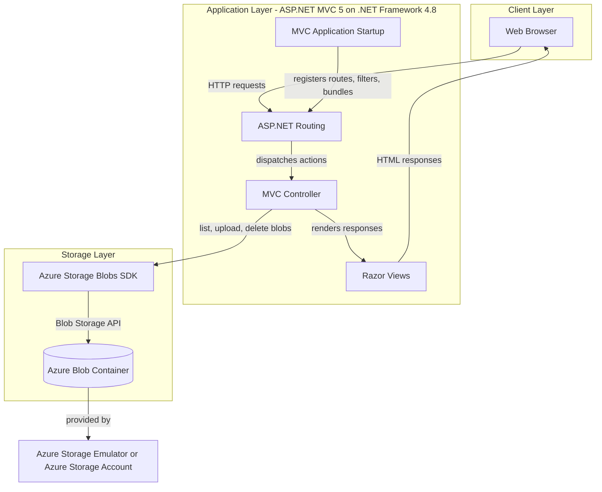
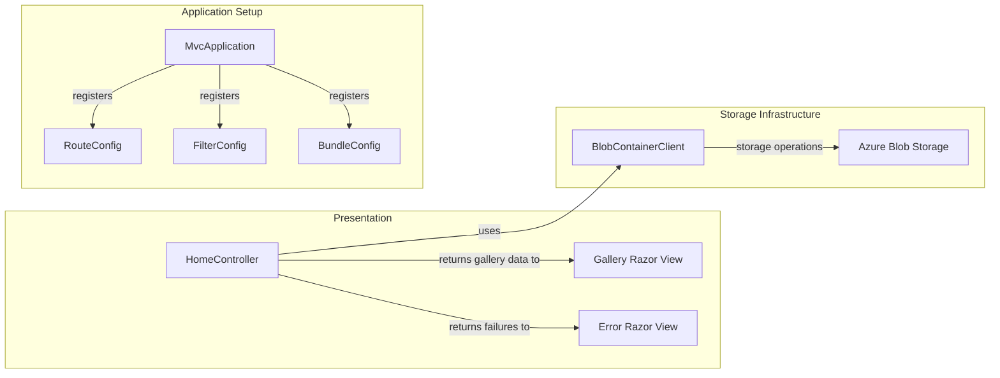

# Architecture Diagram

This is a single-project ASP.NET MVC photo gallery that serves Razor views and stores image files in Azure Blob Storage.

## Application Architecture

### Technology Stack Summary

| Layer | Technology | Version | Purpose |
|---|---|---|---|
| Presentation | ASP.NET MVC | 5.2.3 | Server-side web framework and request routing |
| Runtime | .NET Framework | 4.8 | Application runtime |
| Views | Razor | 3.2.3 | Server-rendered gallery and error pages |
| Storage integration | Azure.Storage.Blobs | 12.9.1 | Listing, uploading, and deleting images |
| Storage | Azure Blob Storage | Azure service / local emulator | Persists gallery image blobs |

### Data Storage & External Services

Images are persisted as block blobs in a single configured Azure Blob Storage container. The default connection string selects the local Azure Storage emulator; deployment configuration can instead point to an Azure Storage account. The application does not declare a relational database, cache, or message broker.

### Key Architectural Decisions

- Uses an MVC controller with Razor views for request handling and HTML rendering.
- The controller accesses Azure Blob Storage directly through the Azure Storage SDK; no separate service or repository layer is present.
- Application startup registers MVC routes, global filters, and asset bundles.

## Component Relationships

### Component Inventory

| Component | Layer | Type | Responsibility |
|---|---|---|---|
| HomeController | Presentation | MVC Controller | Lists, uploads, and deletes gallery images |
| Gallery Razor View | Presentation | MVC View | Displays image links and gallery actions |
| Error Razor View | Presentation | MVC View | Displays application errors |
| MvcApplication | Application Setup | ASP.NET Application | Registers application startup components |
| RouteConfig | Application Setup | MVC Configuration | Registers URL routes |
| FilterConfig | Application Setup | MVC Configuration | Registers global MVC filters |
| BundleConfig | Application Setup | MVC Configuration | Registers CSS and JavaScript bundles |
| BlobContainerClient | Storage Infrastructure | Azure SDK Client | Performs operations against the image container |
| Azure Blob Storage | Storage Infrastructure | External Storage Service | Stores gallery images |
