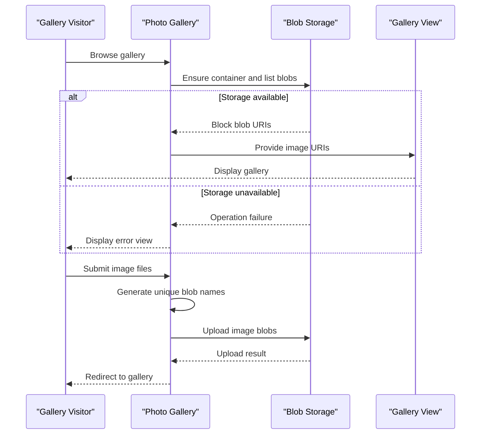

# Core Business Workflows

The application provides a simple photo gallery: users can view images stored in a gallery and submit image uploads or deletion requests. The domain is limited to the gallery and its stored image blobs.

## Domain Entities

| Entity | Service / Bounded Context | Description | Key Relationships |
|---|---|---|---|
| Gallery image blob | WebApp-Storage-DotNet / Photo Gallery | An image available to the gallery and stored in Blob Storage | Belongs to the gallery's configured container |

## Service-to-Domain Mapping

| Service | Domain Context | Owned Entities | External Dependencies |
|---|---|---|---|
| WebApp-Storage-DotNet | Photo Gallery | Gallery image blobs | Azure Blob Storage |

## Primary Workflows

### Workflow 1: Browse the gallery

1. A visitor opens the gallery.
2. The application ensures the image container exists and lists stored blobs.
3. Block-blob URIs are passed to the gallery view for display.
4. If storage access fails, the application returns its error view.

### Workflow 2: Add images

1. A visitor submits one or more files.
2. The application generates a unique blob name while retaining each file's extension.
3. Each file is uploaded to the configured container.
4. On success, the visitor is redirected to the gallery; an exception returns the error view.

### Workflow 3: Remove images

1. A visitor requests deletion of one image or all block blobs.
2. For a single image, the application derives a blob name from the supplied URI and deletes it if it exists; for bulk deletion, it iterates through the container's block blobs.
3. On success, the visitor is redirected to the gallery; an exception returns the error view.

## Cross-Service Data Flows

There are no application-to-application service flows or data composition patterns. The web application reads and mutates its image blobs through Azure Blob Storage; if that external storage call fails, the operation returns the error view rather than using a fallback data source.

## Business Workflow Sequence

## Business Rules & Decision Logic

- Generated upload names combine a time-based value, a GUID, and the original file extension to reduce name collisions.
- Gallery listing includes block blobs only.
- Single-image deletion derives the blob name from the submitted URI; bulk deletion iterates over block blobs and deletes them if present.
- No explicit file validation, business-level authorization, or multi-step state transitions were found.
- Storage errors are caught and rendered through the error view; no retry, compensation, or alternate persistence behavior was found.
