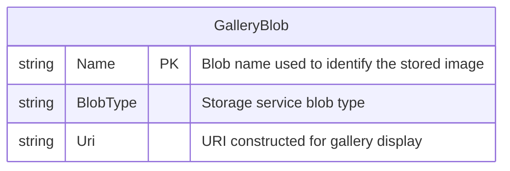

# Data Architecture & Persistence Layer

The application has no relational database, ORM, or application-defined entity model. Its persistent data consists of image blobs stored in one Azure Blob Storage container, accessed directly through the Azure Storage SDK.

## Database Configuration

| Service/Module | DB Type | Profile | Driver | Connection | Migration Tool |
|---|---|---|---|---|---|
| WebApp-Storage-DotNet | Azure Blob Storage (object storage) | Local development default | Azure.Storage.Blobs 12.9.1 | Development storage emulator by default; may be configured for an Azure Storage account | None |

No relational database connection, schema migration, or seed-data mechanism was detected.

## Data Ownership per Service

| Service | Tables Owned | ORM Framework | Caching | Notes |
|---|---|---|---|---|
| WebApp-Storage-DotNet | None; image blobs in the configured container | None | None detected | The MVC controller directly calls the Azure Storage SDK |

## Entity Model

The application defines no database entities or relational relationships. `GalleryBlob` below is a conceptual representation of an externally stored blob and the metadata read by the application; it is not an application entity or a declared database schema.

No transaction manager, ORM mapping, or application-defined entity source file was found.

## Key Repository Methods

| Service | Repository | Notable Methods | Purpose |
|---|---|---|---|
| WebApp-Storage-DotNet | None | None | There are no repository interfaces; storage operations are called directly from the MVC controller through the Azure SDK. |

## Caching Strategy

No application cache, cache provider, cache policy, or cache-related configuration was detected.

## Data Ownership Boundaries

The single web application owns its image gallery data in one Azure Blob Storage container. No separate services, shared relational database, cross-service reads, or CQRS pattern are present. Storage access is directly through the Blob Storage SDK; the application contains no repository abstraction or aggregation layer.

### Data Classification & Sensitivity

| Entity | Sensitive Fields | Classification (PII/PHI/PCI/None) | Controls in Place |
|---|---|---|---|
| GalleryBlob image content | Image contents and associated blob URI may identify people | Potential PII, depending on uploaded images | No application-level data classification, masking, or field-level controls were found. The application creates the container with blob-level public access; storage-service encryption behavior is not configured in the application. |
