# Dependency Map

WebApp-Storage-DotNet declares 34 NuGet package dependencies in `packages.config`; no test-scoped packages are declared.

## Dependencies

```mermaid
flowchart LR
    App["WebApp-Storage-DotNet"]
    subgraph Web["Web Frameworks"]
        Mvc["Microsoft.AspNet.Mvc 5.2.3"]
        Razor["Microsoft.AspNet.Razor 3.2.3"]
        Optimization["Microsoft.AspNet.Web.Optimization 1.1.3"]
        Pages["Microsoft.AspNet.WebPages 3.2.3"]
        Infra["Microsoft.Web.Infrastructure 1.0.0.0"]
    end
    subgraph Storage["Cloud Storage"]
        AzureCore["Azure.Core 1.18.0"]
        AzureBlobs["Azure.Storage.Blobs 12.9.1"]
        AzureCommon["Azure.Storage.Common 12.8.0"]
    end
    subgraph Data["Data and Protocol Libraries"]
        Edm["Microsoft.Data.Edm 5.6.4"]
        OData["Microsoft.Data.OData 5.6.4"]
        ServicesClient["Microsoft.Data.Services.Client 5.6.4"]
        Spatial["System.Spatial 5.6.4"]
    end
    subgraph Frontend["Frontend Libraries"]
        Bootstrap["bootstrap 3.0.0"]
        JQuery["jQuery 1.10.2"]
        JQueryValidation["jQuery.Validation 1.11.1"]
        JQueryUnobtrusive["Microsoft.jQuery.Unobtrusive.Validation 3.2.3"]
        Modernizr["Modernizr 2.6.2"]
        Respond["Respond 1.2.0"]
    end
    subgraph Utilities["Utilities and Runtime Support"]
        Antlr["Antlr 3.4.1.9004"]
        AsyncInterfaces["Microsoft.Bcl.AsyncInterfaces 1.0.0"]
        CodeDom["Microsoft.CodeDom.Providers.DotNetCompilerPlatform 1.0.0"]
        Compilers["Microsoft.Net.Compilers 1.0.0"]
        Newtonsoft["Newtonsoft.Json 6.0.8"]
        Buffers["System.Buffers 4.5.1"]
        Diagnostics["System.Diagnostics.DiagnosticSource 4.6.0"]
        Memory["System.Memory 4.5.4"]
        MemoryData["System.Memory.Data 1.0.2"]
        Numerics["System.Numerics.Vectors 4.5.0"]
        Unsafe["System.Runtime.CompilerServices.Unsafe 4.6.0"]
        Encodings["System.Text.Encodings.Web 4.7.2"]
        Json["System.Text.Json 4.6.0"]
        Tasks["System.Threading.Tasks.Extensions 4.5.2"]
        Tuple["System.ValueTuple 4.5.0"]
        WebGrease["WebGrease 1.5.2"]
    end

    App -->|"web framework"| Mvc
    App -->|"web framework"| Razor
    App -->|"web framework"| Optimization
    App -->|"web framework"| Pages
    App -->|"web infrastructure"| Infra
    App -->|"storage client"| AzureCore
    App -->|"storage client"| AzureBlobs
    App -->|"storage client"| AzureCommon
    App -->|"data protocols"| Edm
    App -->|"data protocols"| OData
    App -->|"data protocols"| ServicesClient
    App -->|"data protocols"| Spatial
    App -->|"browser assets"| Bootstrap
    App -->|"browser assets"| JQuery
    App -->|"browser assets"| JQueryValidation
    App -->|"browser assets"| JQueryUnobtrusive
    App -->|"browser assets"| Modernizr
    App -->|"browser assets"| Respond
    App -->|"runtime support"| Antlr
    App -->|"runtime support"| AsyncInterfaces
    App -->|"runtime support"| CodeDom
    App -->|"runtime support"| Compilers
    App -->|"runtime support"| Newtonsoft
    App -->|"runtime support"| Buffers
    App -->|"runtime support"| Diagnostics
    App -->|"runtime support"| Memory
    App -->|"runtime support"| MemoryData
    App -->|"runtime support"| Numerics
    App -->|"runtime support"| Unsafe
    App -->|"runtime support"| Encodings
    App -->|"runtime support"| Json
    App -->|"runtime support"| Tasks
    App -->|"runtime support"| Tuple
    App -->|"asset processing"| WebGrease
```

### Dependency Summary

| Category | Count | Key Libraries | Notes |
|---|---:|---|---|
| Web Frameworks | 5 | ASP.NET MVC 5.2.3, Razor 3.2.3, WebPages 3.2.3 | Legacy System.Web MVC stack |
| Cloud Storage | 3 | Azure.Storage.Blobs 12.9.1, Azure.Core 1.18.0 | Blob storage client and shared primitives |
| Data and Protocol Libraries | 4 | Microsoft.Data.OData 5.6.4, System.Spatial 5.6.4 | Older OData client dependency family |
| Frontend Libraries | 6 | jQuery 1.10.2, Bootstrap 3.0.0 | Browser-side assets |
| Utilities and Runtime Support | 16 | Newtonsoft.Json 6.0.8, System.Text.Json 4.6.0 | Compiler, framework compatibility, and build/runtime utilities |
| **Total** | **34** | | Declared NuGet package dependencies |

### Version & Compatibility Risks

The project targets .NET Framework 4.8 and uses the classic ASP.NET MVC/System.Web stack, which has no direct in-place move to modern ASP.NET Core. Several dependencies are old, including ASP.NET MVC 5.2.3, Newtonsoft.Json 6.0.8, jQuery 1.10.2, and Bootstrap 3.0.0. Azure Storage client versions also predate current releases; compatibility and API changes should be evaluated during any framework modernization.

### Notable Observations

- The web application and front-end dependencies are maintained through a legacy `packages.config` file rather than SDK-style package references.
- `Microsoft.Net.Compilers` and `Microsoft.CodeDom.Providers.DotNetCompilerPlatform` are old compiler/build dependencies.
- Both Newtonsoft.Json and System.Text.Json are declared, alongside multiple System.* compatibility packages.
- No database/ORM, logging, authentication, or dedicated observability package is declared.

## Test Dependencies

| Framework | Version | Notes |
|---|---|---|
| None detected | — | No test-scoped dependencies are declared in `packages.config` or the project file. |

Total test-scope dependencies: 0

No test dependencies or dedicated automated test project were detected in the solution.
