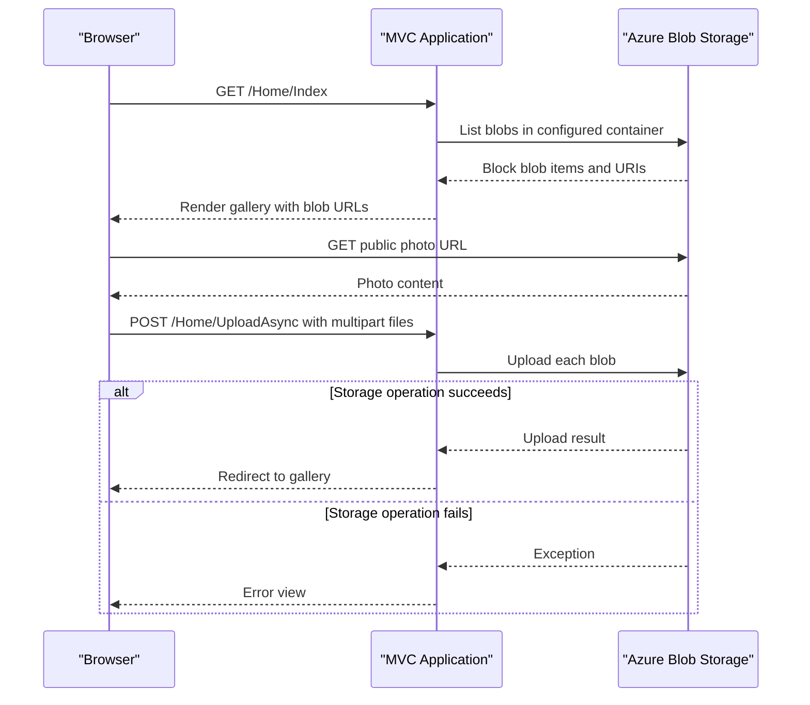

# API & Service Communication Contracts

The application exposes four MVC actions through conventional routes. It uses synchronous browser-to-web HTTP and direct Azure Blob Storage SDK calls; no inter-service API or message broker is configured.

## Service Catalog

| Service | Port | Category | Purpose |
|---|---|---|---|
| WebApp-Storage-DotNet | IIS Express development port 20050; production port unspecified | API Layer / Web UI | Renders the photo gallery and coordinates blob operations |
| Azure Blob Storage | Not specified | Infrastructure | Stores photos and serves blob URLs |

## API Endpoints Inventory

| Service | Method | Path | Request Type | Response Type |
|---|---|---|---|---|
| WebApp-Storage-DotNet | GET | `/Home/Index` | None | HTML view with `List<Uri>` model |
| WebApp-Storage-DotNet | POST | `/Home/UploadAsync` | Multipart form with uploaded files | Redirect to `/Home/Index`, or error view |
| WebApp-Storage-DotNet | POST | `/Home/DeleteImage` | Form field `Name` containing blob URI | Redirect to `/Home/Index`, or error view |
| WebApp-Storage-DotNet | POST | `/Home/DeleteAll` | None | Redirect to `/Home/Index`, or error view |

The default route is `{controller}/{action}/{id}`. No API versioning scheme, explicit status-code contract, or API specification was found.

## Management & Observability Endpoints

| Service | Endpoint | Custom Metrics |
|---|---|---|
| WebApp-Storage-DotNet | None identified | None identified |

No health-check, metrics, tracing, or Swagger endpoint is configured.

## DTOs & Contracts

No dedicated request/response DTOs or immutable contract classes are present. The gallery view receives `List<Uri>`; upload uses ASP.NET `Request.Files`; delete accepts a string form value. `BlobItem` and `BlobClient` are Azure SDK types, not application-owned API DTOs. No OpenAPI, protobuf, or GraphQL contract is present. Package declarations include Newtonsoft.Json and System.Text.Json, but no application serialization configuration was found.

## Communication Patterns

The browser communicates with the MVC application over HTTP. The controller makes direct calls to Azure Blob Storage: listing operations use synchronous SDK calls, while container creation, uploads, and deletes use asynchronous calls in some actions. No queues, events, retries, circuit breakers, service discovery, load balancing, or API gateway are configured. The application stores a static BlobContainerClient and initializes it in the gallery action.

No authentication, authorization, or application-level TLS configuration was identified. The container is created with blob-level public read access; storage URLs are returned to browsers. IIS Express is configured for local HTTP on port 20050; production transport settings are not included.

## Service Technology Matrix

| Service | Web | Data Access | Discovery | Gateway | Health | Cache | Metrics |
|---|---|---|---|---|---|---|---|
| WebApp-Storage-DotNet | ASP.NET MVC 5 | Azure Blob SDK | None | None | None | None | None |
| Azure Blob Storage | Azure service | Blob API | Azure-managed | None | Azure-managed | Not identified | Not identified |

## Service Communication Sequence

