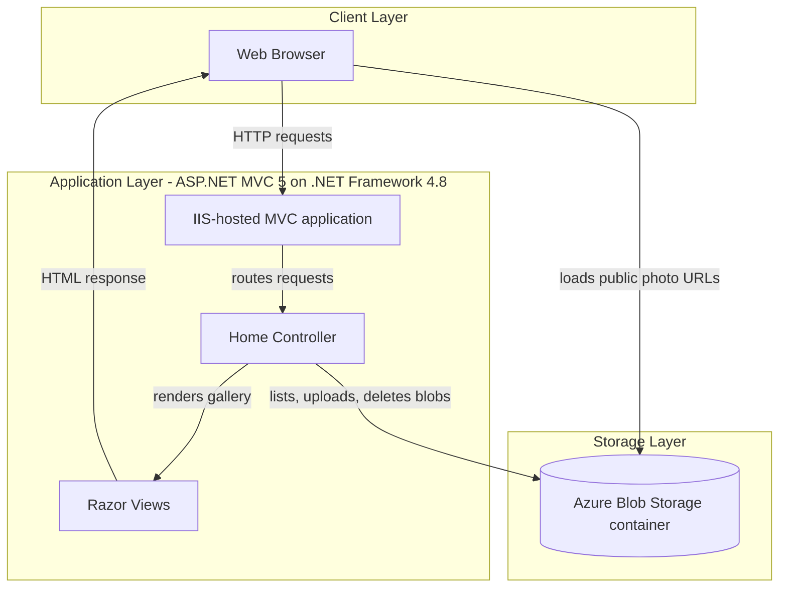
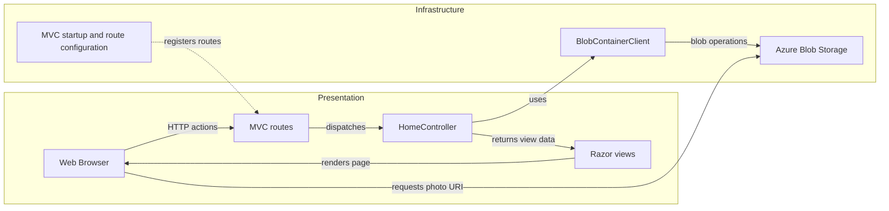

# Architecture Diagram

PhotoGallery is a single ASP.NET MVC web application that presents photos stored in Azure Blob Storage. Browsers retrieve the gallery page from the application and load public blob URLs directly from the storage service.

## Application Architecture

### Technology Stack Summary

| Layer | Technology | Version | Purpose |
|---|---|---|---|
| Presentation | ASP.NET MVC | 5.2.3 | Handles gallery requests and renders Razor views |
| Runtime | .NET Framework | 4.8 | Hosts the web application |
| View | ASP.NET Razor | 3.2.3 | Renders gallery and upload UI |
| Storage | Azure.Storage.Blobs | 12.9.1 | Lists, uploads, and deletes photo blobs |
| Browser assets | jQuery, Bootstrap | 1.10.2, 3.0.0 | Client-side UI and form behavior |

### Data Storage & External Services

The application stores image objects in one Azure Blob Storage container and has no relational database, cache, or message broker. The controller lists and mutates blobs; the browser receives blob URIs and loads them directly. The container is created with blob-level public read access.

### Key Architectural Decisions

- A single MVC controller coordinates the UI and Azure Blob Storage operations; no separate service or repository layer is present.
- Blob data is exposed through direct storage URLs rather than proxied through the web application.
- Listing and deletion use synchronous SDK operations while create/upload/delete operations are asynchronous in some actions.

## Component Relationships

### Component Inventory

| Component | Layer | Type | Responsibility |
|---|---|---|---|
| HomeController | Presentation | MVC Controller | Lists, uploads, and deletes gallery blobs |
| Index.cshtml | Presentation | Razor View | Displays photos and provides upload/delete actions |
| RouteConfig | Infrastructure | MVC Configuration | Maps controller/action URL routes |
| MvcApplication | Infrastructure | Startup | Registers MVC routes, filters, and bundles |
| BlobContainerClient | Infrastructure | Azure SDK client | Performs operations on the configured container |
| Azure Blob Storage | Infrastructure | External service | Persists image blobs and serves public blob URLs |
