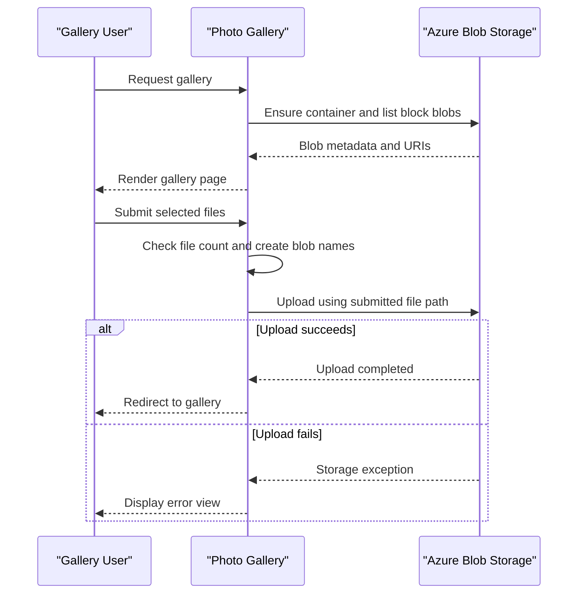

# Core Business Workflows

PhotoGallery is a photo gallery that lets a user view images stored in a cloud blob container, upload images, and remove one or all stored images. The application exposes a single gallery workflow backed by Azure Blob Storage.

## Domain Entities

| Entity | Service / Bounded Context | Description | Key Relationships |
|---|---|---|---|
| PhotoBlob | Photo Gallery | An image object displayed by the gallery | Stored in one BlobContainer |
| BlobContainer | Photo Storage | Collection that contains gallery image objects | Contains many PhotoBlob objects |

## Service-to-Domain Mapping

| Service | Domain Context | Owned Entities | External Dependencies |
|---|---|---|---|
| WebApp-Storage-DotNet | Gallery presentation and photo management | No independent database-owned entities; coordinates PhotoBlob operations | Azure Blob Storage |
| Azure Blob Storage | Photo persistence | BlobContainer and PhotoBlob objects | None identified |

The storage service is the source of truth for photo data. The application retrieves blob URIs and the browser loads public photo content directly from storage; no inter-service exchange is present.

## Primary Workflows

### Workflow 1: View the Gallery

1. The browser requests the gallery page.
2. `HomeController.Index` constructs a storage client, obtains the configured container, and ensures the container exists with blob-level public read access.
3. The application enumerates block blobs and passes their URIs to the Razor view.
4. The browser renders thumbnails and loads image content using the blob URLs.

### Workflow 2: Upload Photos

1. The user selects one or more files and posts a multipart request.
2. `HomeController.UploadAsync` checks that the request has at least one file and generates a new blob name from the current tick count, a GUID, and the original file extension.
3. The controller uploads each file and redirects to the gallery. The implementation passes the submitted `FileName` to the SDK's path-based upload overload.
4. Storage failures return the error view. No file type, size, or per-request file-count validation is implemented in the controller.

### Workflow 3: Delete Photos

The individual-delete action extracts a filename from the submitted URI and deletes that blob if it exists. The bulk-delete action enumerates the container and deletes block blobs. Both actions redirect to the gallery on success and return the error view on exceptions.

## Cross-Service Data Flows

There is no multi-service aggregation. The application asks Azure Blob Storage for blob metadata and URIs, renders them in the gallery, and allows the browser to retrieve public blob content directly. Upload and delete requests are synchronous user workflows that invoke storage SDK operations; no fallback or offline store is configured.

## Business Workflow Sequence

## Business Rules & Decision Logic

- The upload action proceeds only when the submitted file count is greater than zero; no additional type, size, or request-count rules are enforced in the controller.
- New blob names combine a timestamp, a random GUID, and the original extension.
- Individual deletion targets the last path segment of the submitted URI; bulk deletion handles block blobs only.
- There is no explicit authentication, role check, ownership rule, or audit trail for gallery operations.
- Storage exceptions are sent to the error view with exception details and stack trace. No transaction, compensation, or retry policy is configured.
