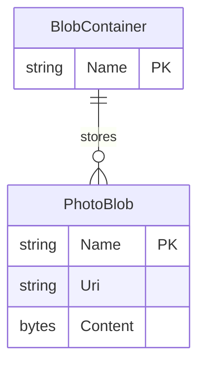

# Data Architecture & Persistence Layer

The application has no relational entity model or database; it persists photo objects in a single Azure Blob Storage container. The storage SDK provides the application's data access boundary.

## Database Configuration

| Service/Module | DB Type | Profile | Driver | Connection | Migration Tool |
|---|---|---|---|---|---|
| WebApp-Storage-DotNet | Azure Blob Storage, not a relational database | Single Web.config configuration | Azure.Storage.Blobs 12.9.1 | App setting defaults to `UseDevelopmentStorage=true` | None |

## Data Ownership per Service

| Service | Tables Owned | ORM Framework | Caching | Notes |
|---|---|---|---|---|
| WebApp-Storage-DotNet / Azure Blob Storage | Photo blobs in `webappstoragedotnet-imagecontainer` | None; Azure Blob SDK | None | The application stores unstructured image objects |

## Entity Model

The only application data object is a photo blob. The container groups the blobs; no relational tables, foreign keys, ORM entities, or transaction manager were found.

## Key Repository Methods

| Service | Repository | Notable Methods | Purpose |
|---|---|---|---|
| WebApp-Storage-DotNet | No repository interface | `BlobContainerClient.GetBlobs()` | Enumerates blobs for the gallery and bulk deletion |
| WebApp-Storage-DotNet | No repository interface | `BlobContainerClient.GetBlobClient(name)` | Obtains a blob client for upload or individual delete |
| WebApp-Storage-DotNet | No repository interface | `BlobClient.UploadAsync(path)` | Uploads a local file path as a blob |
| WebApp-Storage-DotNet | No repository interface | `DeleteIfExistsAsync()` / `DeleteBlobIfExistsAsync(name)` | Deletes one blob or a listed set of blobs |

## Caching Strategy

No application cache, cache provider, or cache-aside/read-through pattern is configured. Blob contents are fetched directly from Azure Storage.

## Data Ownership Boundaries

The Azure container is the sole persistence store and the application's source of truth for photos. There is one deployable application and no cross-service database access, CQRS, or aggregation across services. The web tier obtains storage object URIs and the browser then reads blob content directly from the storage service.

### Data Classification & Sensitivity

| Entity | Sensitive Fields | Classification | Controls in Place |
|---|---|---|---|
| PhotoBlob | Image content and metadata may contain personal information | Potential PII | No field-level access or masking is present; container creation requests blob-level public read. No application-level encryption configuration is present. |
