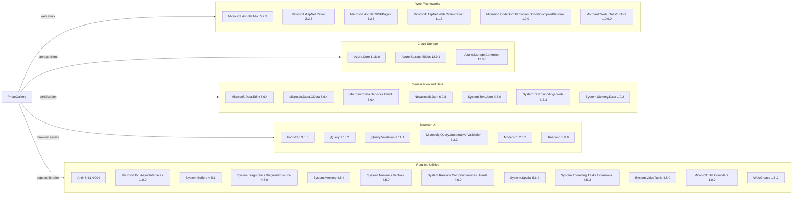

# Dependency Map

PhotoGallery declares 34 NuGet packages in `WebApp-Storage-DotNet/packages.config`; none are test-scoped. The diagram groups the declared packages by role.

## Dependencies

### Dependency Summary

| Category | Count | Key Libraries | Notes |
|---|---:|---|---|
| Web Frameworks | 6 | ASP.NET MVC 5.2.3, Razor 3.2.3, WebPages 3.2.3 | Legacy ASP.NET MVC stack |
| Cloud Storage | 3 | Azure.Storage.Blobs 12.9.1, Azure.Core 1.18.0 | Azure Blob client and shared SDK |
| Serialization and Data | 7 | Newtonsoft.Json 6.0.8, System.Text.Json 4.6.0, OData 5.6.4 | No database provider or ORM declared |
| Browser UI | 6 | Bootstrap 3.0.0, jQuery 1.10.2 | Legacy client libraries bundled with the app |
| Runtime Utilities | 12 | System.Memory 4.5.4, System.Text dependencies, Antlr 3.4.1.9004 | Framework and build-support packages |
| **Total** | **34** |  | From `packages.config`; transitive resolution unavailable |

### Version & Compatibility Risks

The application targets .NET Framework 4.8 and uses an older MVC 5 stack. Several packages are old, including jQuery 1.10.2, Bootstrap 3.0.0, Newtonsoft.Json 6.0.8, and Microsoft.Net.Compilers 1.0.0. AppCAT dependency analysis could not resolve the legacy project because Visual Studio WebApplication MSBuild targets are not installed in the Linux environment; dependency counts therefore reflect declared packages only.

### Notable Observations

- No database or ORM packages are declared; Azure Blob Storage is the persistence service.
- Both Newtonsoft.Json and System.Text.Json are declared, although no use of either was found in the application source.
- UI libraries are checked into the project alongside NuGet declarations, and no lock file is present.

## Test Dependencies

| Framework | Version | Notes |
|---|---|---|
| None detected | — | No test project or test-scoped packages found |

Total test-scope dependencies: 0

No test framework or integration-test infrastructure is configured in the solution.
